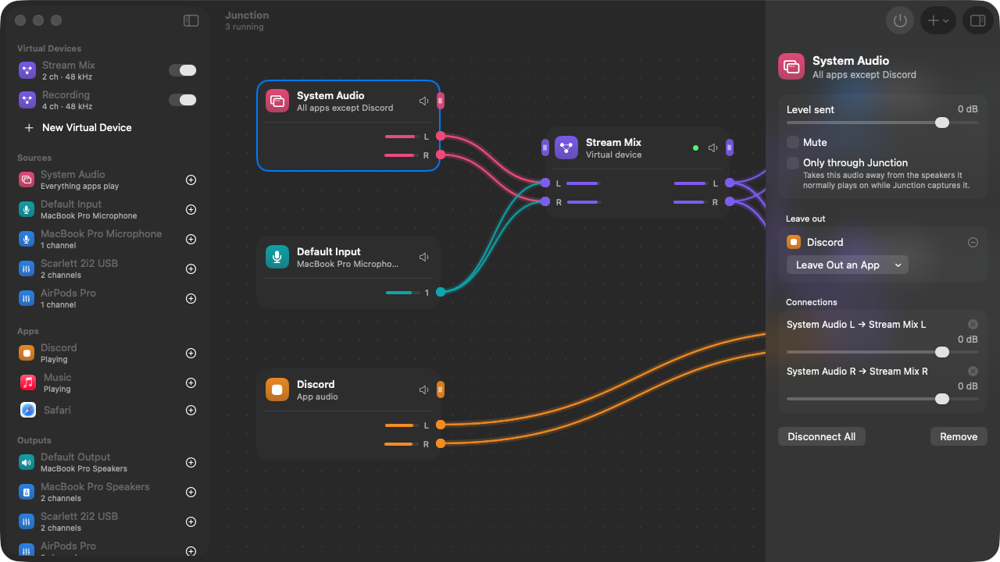
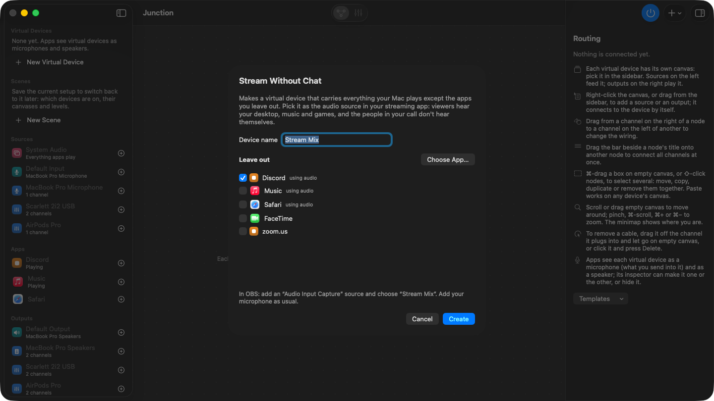

# Junction

A macOS app (SwiftUI, Liquid Glass) for making virtual audio devices and routing apps, system audio, microphones and
interfaces into them, each on its own node-and-cable canvas.

**New to Junction? Read the [user guide](docs/GUIDE.md)**: installing, making devices, wiring them up, and streaming
without your voice chat, step by step.

- **Virtual devices** (sidebar): create, rename, set 1–64 channels and a sample rate, and switch each one on or off.
  Every app sees an enabled device as both a microphone and a speaker. Anything sent into it comes back out, so a
  streaming, call or recording app can record what Junction (or another app) plays into it.
- **A canvas per device**: pick a virtual device in the sidebar to see its canvas. Sources on the left feed it;
  outputs on the right (headphones, speakers) let you hear it. Add them from the sidebar, **+** in the toolbar, or by
  right-clicking the canvas (the node lands where you clicked); a new node is wired to the device straight away. Drag
  from a channel on the right of a node to a channel on the left of another to change the wiring; the bar beside a
  node's title connects all channels at once. To move or remove a cable, drag it off the channel it plugs into: drop
  it on another channel to move it, or on empty canvas (it turns red) to remove it. Clicking a cable and pressing
  Delete works too, and right-clicking the device offers **Disconnect** for each node wired to it. Meters show levels;
  cables glow with the audio they carry; dashed cables carry nothing right now (an end is missing or routing is off).
- **No feedback**: every cable runs into the canvas's virtual device or out of it, so devices never feed each other.
  Junction also refuses (or, if Sound settings change later, mutes) a device sent to Default Output while Sound
  settings play through that same device, and Default Input into the device it stands for.
- **Inspector**: level and mute per node and per cable (Option- or Command-click a fader to put it back to 0 dB), the
  virtual device's settings, the apps a System Audio node leaves out, and any problem a node has. A cable shows its
  approximate delay; a receiving node (virtual device or output) has a buffer size (64–1024 frames, or automatic).
- **Routing** (toolbar power button, menu bar, ⇧⌘R) starts and stops everything. Junction keeps routing from the menu
  bar when the window is closed. **Settings** (⌘,) can open Junction at login (`SMAppService`) and hide its Dock icon
  so it lives in the menu bar only.
- **Routing Log** (Routing › Show Routing Log, ⌥⌘L): what the router did and why (started, rebuilt, failed, trying
  again, tap membership). Events are also appended to `events.log` next to `graph.json`. **Copy Report** (or
  `Junction --diagnose`) makes a plain-text report for bug reports; it names your devices and apps.

| Node | Left side (receives) | Right side (provides) |
| --- | --- | --- |
| Virtual device | what you send into it | what comes out of it (also what apps play into it) |
| Audio device / interface | its playback channels | its input channels |
| Default Output / Default Input | follows the device chosen in Sound settings | |
| App | | that app's sound (stereo, helpers included) |
| System Audio | | everything apps play, except the apps you leave out and Junction itself |

App and System Audio nodes can take their audio away from the speakers it normally plays on (**Only through
Junction**), so it is heard only where you route it.

<picture>
  <source media="(prefers-color-scheme: light)" srcset="docs/screenshots/canvas-light.png">
  
</picture>

### Stream without chat

**Stream Without Chat…** (File menu, empty canvas, inspector) builds the common setup in one step: a virtual device
("Stream Mix") fed by System Audio with Discord (or any chat app) left out. It offers the apps using audio and the
chat apps installed on your Mac; **Choose App…** adds any other. In OBS add an Audio Input Capture source
for "Stream Mix": viewers hear the desktop, music, games and DAW; the people in the call don't hear themselves. Your
own monitoring is unchanged.

<picture>
  <source media="(prefers-color-scheme: light)" srcset="docs/screenshots/stream-template-light.png">
  
</picture>

*Screenshots made with Junction's snapshot mode on a made-up set of devices (see Development); GitHub shows the
light or dark set to match your theme.*

Junction is open source under the GNU General Public License, version 3 or later (`LICENSE`). Copyright (C) 2026 omso.

## Install and run

```sh
./build.sh                       # builds build/Junction.app (ad-hoc signed) with the driver inside
open build/Junction.app
```

The first time, the sidebar and canvas offer **Install Driver…**: macOS asks for an administrator password, the driver
is copied to `/Library/Audio/Plug-Ins/HAL/JunctionDriver.driver` and Core Audio restarts (all sound stops for a
moment). By hand: `sudo sh scripts/install-driver.sh build/JunctionDriver.driver`; remove it with **Routing ›
Uninstall Driver…** or `sudo sh scripts/uninstall-driver.sh`.

Each copy of Junction carries its own driver, versioned separately from the app (`Driver/VERSION`, bumped only when
the driver changes, so an app update doesn't ask for the driver again). When it is newer than the installed one,
the sidebar, the menu bar and the Routing menu offer **Update Driver…** with both versions; an older copy of Junction says so and doesn't offer to go
back. Whenever Core Audio restarts (a driver install or update, or a crash), Junction rebuilds its routing by itself.
It also rebuilds a single device's routing when a device it uses changes sample rate or channels, or when its audio
stops moving (checked every 2 s, e.g. after sleep). Routing that fails to start is tried again after 2, 4, 8… up to
60 seconds, and the node says why and when.

macOS asks for two permissions the first time routing needs them: **Microphone** (reading any input, including
Junction's own devices) and **System Audio Recording** (App and System Audio nodes). Junction asks for Microphone
access itself as soon as routing needs it; if it's refused, a banner opens the right System Settings page, and
routing is rebuilt once it's allowed. macOS offers no way to check System Audio Recording, so an App or System Audio
node that hears nothing for 8 s while the apps it captures are playing shows a hint with a button to that page
instead. With ad-hoc signing macOS asks
again after every rebuild; build with `SIGN_IDENTITY="Apple Development: …" ./build.sh` (or the older
`JUNCTION_SIGN_IDENTITY`) to keep them. A Developer ID identity also turns on the hardened runtime with
`Resources/Junction.entitlements` (audio input), as notarization requires.

Requires macOS 26 (Liquid Glass and app capture by bundle ID) and Xcode 26 or newer; the scripts use Xcode's toolchain.

## How it works

Three parts:

1. **Driver** (`Driver/JunctionDriver.c`): a Core Audio HAL plug-in (AudioServerPlugIn) loaded by `coreaudiod`. It
   publishes up to 32 loopback devices. The app sends it the list of enabled devices through a custom property on the
   plug-in object (`jcfg`: uid, name, channels, sample rate); the driver adds, renames, reshapes (through the host's
   configuration-change path) and removes devices to match, and saves the list in Core Audio's own storage so the
   devices exist after a restart even when Junction isn't running. Audio written to a device's output lands in a ring
   buffer indexed by sample time and is read back by its input.
2. **Planner** (`Sources/JunctionCore/Planner.swift`): turns the graph into one plan per destination ("sink"): a
   private aggregate device whose first sub-device is the sink (the clock), followed by every source device (with
   drift compensation) and one process tap per App/System Audio node. It drops cables that would feed a virtual
   device back into itself (for example via Default Output set to that device), and notes sample-rate mismatches and
   missing devices.
3. **Router** (`Router.swift` + the C kernel in `Sources/JunctionKernel`): builds the taps and aggregate devices and
   runs one IOProc per sink. The IOProc is plain C (no Swift reference counting, locks or allocation on the audio
   thread): it copies aggregate input channels to sink output channels with gains that glide over one buffer, and
   keeps peak meters. Gain and mute changes don't rebuild anything; adding or removing cables rebuilds only the sinks
   they touch. A rebuilt sink is built next to the running one, then the two cross-fade over 25 ms, so edits don't
   leave a gap or click. When apps start or quit, taps are updated in place.

The graph is saved to `~/Library/Application Support/Junction/graph.json` (schema 3: nodes belong to a device's
canvas, and receiving nodes can set a buffer size). A schema 1 file from the shared-canvas versions is converted on
load: each node moves to the canvas of the device it was wired to (unwired ones to the first device), and cables
between devices are dropped. Schema 2 files load unchanged, with automatic buffer sizes.

## Development

```sh
./test.sh                                        # engine tests + driver harness (sanitizers), installs nothing
build/Junction.app/Contents/MacOS/Junction --self-test   # bundled driver loads, planning, kernel, saving
build/Junction.app/Contents/MacOS/Junction --list        # driver status, devices, apps using audio
build/Junction.app/Contents/MacOS/Junction --diagnose [file]   # bug report: versions, devices, plan, events, setup
build/Junction.app/Contents/MacOS/Junction --loopback-test   # with the driver installed: tone in, tone out
build/Junction.app/Contents/MacOS/Junction --device-test     # with the driver installed: add, rename, reshape, remove
JUNCTION_SNAPSHOT=/tmp/shots build/Junction.app/Contents/MacOS/Junction   # demo screenshots, light and dark
```

The driver harness (`Tests/DriverHarness/harness.c`) loads the driver into a test process with a stand-in Core Audio
host and checks the device list, properties, configuration changes, saved state across a simulated restart and
bit-exact loopback. `--loopback-test` is the real-system check: it adds a temporary device, plays 997 Hz into it,
records its input, and restores the device list. It needs microphone permission for the app running it (Terminal).
`--device-test` checks that Core Audio follows the driver (a temporary device appears, is renamed, changes channels
and rate, reports a rate set from outside, disappears and returns); it opens no audio and needs no permission.

`omso-build.json` describes the build for omso Builder: `build.sh`, `test.sh`, then `Junction --self-test`;
**Build & Install** copies `Junction.app` to `/Applications/omso`. Installing the driver stays a separate,
password-protected step in the app.

The icon is drawn by `icon/make_icon.swift`; `icon/make-icns.sh` rebuilds `Resources/AppIcon.icns`.

## Updates and releases

Released copies update themselves with [Sparkle](https://sparkle-project.org) 2.10.1 (pinned in
`Package.swift`). A plain `./build.sh`, and omso Builder's builds, have no update feed: they never check for
updates and show no update menu items.

A release build gets its feed and key from the environment; the release tool in the `software-site` repository
sets them:

| Variable | What it does |
| --- | --- |
| `UPDATE_FEED_URL` | the update feed, `<site>/updates/junction/appcast.xml` |
| `UPDATE_PUBLIC_KEY` | the EdDSA public key; an update signed with any other key is refused |
| `SIGN_IDENTITY` | codesign identity: a Developer ID for releases (default: ad-hoc) |

Such a build has **Check for Updates…** and **Check for Updates Automatically** in the app menu, and **Check for Updates…** in the menu bar menu. Sparkle
asks on the second launch whether to check automatically, and sends nothing before that. A check downloads the
feed from the site; the request names the app and its version, and system profiling stays off, so nothing about
the Mac is sent (the server sees the IP address, as with any web request).

To release: bump `VERSION`, commit, then run `python3 release.py junction --notes "…"` in the site repository.
`sh scripts/test-update.sh junction` there tests a real update end to end with a throwaway key, including refusing an
update signed with another key. Sparkle's XPC services are left out of the app because Junction isn't sandboxed.

An app update replaces Junction.app only. The driver inside it is offered separately, as above, and only when
`Driver/VERSION` went up. A Developer ID build with the hardened runtime hasn't been tried yet: check microphone and
system-audio permissions and **Install Driver…** with the first one.

## Known limits

- Not yet run end to end: the driver installs and passes its device and loopback tests, but the permission prompts
  and audio through real taps and aggregate devices haven't been tried with real hardware yet.
- Sources and the sink are kept in step by Core Audio's drift compensation. Devices at different nominal sample rates
  are flagged on the node; set them to the same rate for the best quality.
- Safari and other WebKit apps play through one shared process ("Safari & Web Views"), so they can only be captured
  or left out together.
- Cross-fading a rebuilt sink (when cables are added or removed) hasn't been tried with real audio yet.
- Routing stops when Junction quits; it keeps running from the menu bar when the window is closed.
- Virtual devices have no volume control yet, so the keyboard volume keys don't change them.
- Virtual devices can't feed each other; to use the same source in two devices, add it to both canvases.
- A virtual device's sample rate can also be set by other apps (Audio MIDI Setup, a DAW), and macOS puts back the rate
  it remembers for a device when it appears. Junction insists on its own rate for a few seconds after you create, turn
  on or change a device, and otherwise adopts the outside change rather than fighting it.
