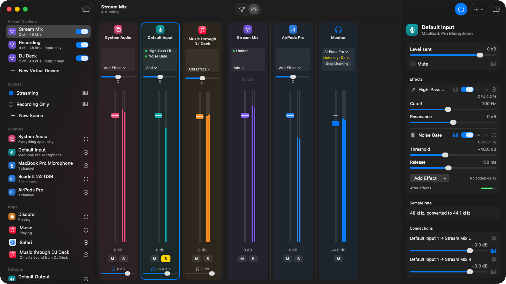

# Junction

A macOS app (SwiftUI, Liquid Glass) for making virtual audio devices and routing apps, system audio, microphones and
interfaces into them, each on its own node-and-cable canvas.

**New to Junction? Read the [user guide](docs/GUIDE.md)**: installing, making devices, wiring them up, and streaming
without your voice chat, step by step.

- **Virtual devices** (sidebar): create, rename, set 1–64 channels and a sample rate, and switch each one on or off.
  Each one can also show apps only one side (**input only**: a microphone; **output only**: a speaker), be hidden
  from apps' device lists, name its channels, and pick an icon (shown in Audio MIDI Setup). Its volume and mute per
  side are the ones Sound settings and the volume keys change; Junction shows and sets them in the inspector.
  Every app sees an enabled device as both a microphone and a speaker. Anything sent into it comes back out, so a
  streaming, call or recording app can record what Junction (or another app) plays into it.
- **A canvas per device**: pick a virtual device in the sidebar to see its canvas. Sources on the left feed it;
  outputs on the right (headphones, speakers) let you hear it. Add them from the sidebar (click ⊕, or drag them onto
  the canvas: they land where you drop them, and dropped on a cable they join its channels), **+** in the toolbar, or
  by right-clicking the canvas (the node lands where you clicked); a new node is wired to the device straight away. Drag
  from a channel on the right of a node to a channel on the left of another to change the wiring; the bar beside a
  node's title connects all channels at once. To move or remove a cable, drag it off the channel it plugs into: drop
  it on another channel to move it, or on empty canvas (it turns red) to remove it. Clicking a cable and pressing
  Delete works too, and right-clicking the device offers **Disconnect** for each node wired to it. Meters show levels;
  cables glow with the audio they carry; dashed cables carry nothing right now (an end is missing or routing is off).
- **Effects**: every node has an effect chain in its inspector. On a source it processes that source before the mix;
  on the virtual device, the mix before it goes into the device (what apps recording it hear); on an output, what it
  receives. Gain, pan, mono and a noise gate are built in; a high-pass filter, a three-band equalizer, a compressor
  and a limiter are Apple's Audio Units. Each effect can be bypassed and moved up or down; the inspector shows the
  levels after the chain and the delay it adds (also counted in the destination's delay), and each effect's CPU share
  and delay while it runs. On the canvas, a node with effects lists them in a row under its channels; clicking one
  bypasses it or turns it back on.
- **Calibration** (outputs only): makes speakers or headphones sound flat, or follow a curve you like. Speakers are
  measured in the room: **Calibrate Speakers…** (in the Calibration inspector, or the output's context menu, which adds
  the effect if there is none) opens a guided sheet. Pick the measurement microphone, its input channel and its
  calibration file (or go on without one, with a note on what that costs in accuracy) and the speakers to measure,
  named as the output names its channels; after a level check, Junction plays a sine sweep on each speaker at 1 to 9
  listening positions (7 by default: ear height where you sit first, then within about 30 cm), with a diagram of
  where to put the microphone, progress, **Redo Last** and dropping a position. The results show, per speaker, the
  average and each position, the target, the correction and the predicted result; tilt, bass and treble shelves, the
  correction range, the most boost, the number of filters and lining the speakers up (delay and level) refit at once
  from the saved measurements, and a **Before/After** switch compares with the correction off at matched loudness.
  **Save** puts the profile into the effect (undoable); **Adjust…** reopens the results later without measuring.
  Headphones use a parametric EQ preset
  loaded from a text file (**Load EQ Preset…**; the usual "Preamp: …" and "Filter 1: ON PK Fc … Gain … Q …" lines).
  The inspector shows the preset's name, what kind it is, its date and the device it was made for, and its curve on
  a 20 Hz–20 kHz graph; **Amount** scales the correction and **Export EQ Preset…** saves it as text again. It warns
  when the output now plays on another device than the profile's (Default Output follows Sound settings). The
  correction is a cascade of minimum-phase filters, so it adds no delay. Everything runs inside Junction: nothing is
  downloaded or bundled.
- **Audio Unit plugins**: **Add Effect › Audio Unit…** lists every effect Audio Unit installed on the Mac by maker,
  with a search field. A plugin opens its own window (**Open Window**) in the process that routes, runs in a process
  of its own where macOS allows it, and is saved with the setup, settings made in its window included. One that keeps
  holding up the audio thread is offered for bypass; each destination counts its overloads. A plugin that isn't
  installed shows as missing, passes the audio through and keeps its saved settings.
- **Mixer** (⌘2): the shown canvas as channel strips, one per source, the device and each output, with faders, pan,
  mute, solo, meters and effects, editing the same graph as the canvas; plus a **headphone monitor** per device with
  its own levels, and solo/listen on any strip or port that doesn't change the device's mix.
- **Navigation**: zoom about the pointer with a pinch or ⌘-scroll, or with ⌘+, ⌘−, ⌘0 (actual size) and ⌥⌘0 (fit);
  scroll or drag empty canvas to move around. A minimap shows the whole canvas and where you are; click it to go
  there.
- **Keyboard and VoiceOver**: nodes, channels, cables and meters have VoiceOver labels and values. To connect from
  the keyboard, select a node, press → or ← to reach its channels, press Return, pick the other channel from the list
  and press Return.
- **Editing**: select several nodes with a ⌘-drag box or ⇧-click, move them together, and cut, copy, paste or duplicate
  (⌘D) them with the cables between them, onto the same canvas or another device's (cables plug into that device;
  ones it doesn't allow are left out). **Tidy Up** (⌃⌘T) lays a canvas out: sources, device, outputs. Every canvas
  and virtual-device edit can be undone and redone (⌘Z, ⇧⌘Z).
- **No feedback**: every cable runs into the canvas's virtual device or out of it, so devices never feed each other.
  Junction also refuses (or, if Sound settings change later, mutes) a device sent to Default Output while Sound
  settings play through that same device, and Default Input into the device it stands for.
- **Inspector**: level and mute per node and per cable (Option- or Command-click a fader to put it back to 0 dB), the
  virtual device's settings, the apps a System Audio node leaves out, and any problem a node has. A cable shows its
  approximate delay; a receiving node (virtual device or output) has a buffer size (64–1024 frames, or automatic) and
  a sample-rate conversion setting.
- **Sample-rate conversion**: a device running at another rate than the virtual device it feeds or plays is
  converted, and its node shows it ("44.1 kHz, converted to 48 kHz"). **Automatic** is the default; **Off** combines
  the devices as they are, which needs them set to the same rate.
- **Routing** (toolbar power button, menu bar, ⇧⌘R) starts and stops everything. Junction keeps routing from the menu
  bar when the window is closed. **Settings** (⌘,) can open Junction at login (`SMAppService`; it then starts in the
  menu bar without its window) and hide its Dock icon so it lives in the menu bar only.
- **Routing in the background** (builds made with `ROUTING_HELPER=1`; off by default, release builds included, until
  it has been tried on a real Mac): routing runs in **Junction Helper**, a small helper without a Dock icon inside
  Junction.app. Settings says "Routing runs in the background" and has **Keep routing after quitting Junction**: with
  it on, routing goes on after Junction quits and starts again at login; with it off (the default) the helper stops
  with Junction. To turn the helper off altogether, switch Junction off in System Settings › General › Login Items &
  Extensions; Junction then routes by itself, as plain builds always do.
- **Routing Log** (Routing › Show Routing Log, ⌥⌘L): what the router did and why (started, rebuilt, failed, trying
  again, tap membership). Events are also appended to `events.log` next to `graph.json`. **Copy Report** (or
  `Junction --diagnose`) makes a plain-text report for bug reports; it names your devices and apps.
- **Driver installs without a password** (builds made with `DRIVER_DAEMON=1`; off by default, like the helper): once
  Junction is allowed in Login Items, its driver installer installs, updates and removes the driver with no password
  prompt, and only the copy inside Junction, signed like it. **Settings** shows whether it's allowed.
- **Crash reports** (opt-in in Settings): after a crash, the next launch shows the whole report (the diagnostic
  report and macOS's crash log) and offers **Send Report** in release builds, or **Copy Report**.
- **Uninstall Junction…** (Settings): removes the driver, both helpers and the login item, and on request the saved
  setup and settings.

| Node | Left side (receives) | Right side (provides) |
| --- | --- | --- |
| Virtual device | what you send into it | what comes out of it (also what apps play into it) |
| Audio device / interface | its playback channels | its input channels |
| Default Output / Default Input | follows the device chosen in Sound settings | |
| App | | that app's sound (stereo, helpers included) |
| *App* through *virtual device* | | what that app plays into another of Junction's devices, on its own (up to 8 channels) |
| System Audio | | everything apps play, except the apps you leave out and Junction itself |

App and System Audio nodes can take their audio away from the speakers it normally plays on (**Only through
Junction**), so it is heard only where you route it.

**Per-app capture through a virtual device**: when an app plays into one of Junction's virtual devices, the sidebar's
Apps section and the + menu offer "*app* through *device*" on the other devices' canvases: just that app's sound
from that device, taken in the driver before the device mixes its apps together. It counts as the device's own audio
for the feedback rules. It needs Junction Driver Installer, so only builds made with `DRIVER_DAEMON=1` can hear it.

<picture>
  <source media="(prefers-color-scheme: light)" srcset="docs/screenshots/canvas-light.png">
  
</picture>

### Stream without chat

**Stream Without Chat…** (File menu, the + menu, the empty canvas's and inspector's Templates menu) builds the common setup in one step: a virtual device
("Stream Mix") fed by System Audio with Discord (or any chat app) left out. It offers the apps using audio and the
chat apps installed on your Mac; **Choose App…** adds any other. In OBS add an Audio Input Capture source
for "Stream Mix": viewers hear the desktop, music, games and DAW; the people in the call don't hear themselves. Your
own monitoring is unchanged.

<picture>
  <source media="(prefers-color-scheme: light)" srcset="docs/screenshots/stream-template-light.png">
  
</picture>

### More templates

Next to it, three more sheets build a virtual microphone (an input-only device) in one step:

- **Podcast…**: two microphones and a call into a recorder device, each on a channel pair of its own (microphone 1
  on channels 1–2, microphone 2 on 3–4, the call on 5–6), so the recording app gets every voice on separate tracks.
  Two inputs of one interface share its node.
- **DAW into a Call…**: what a music app plays (optionally with your microphone) as the call app's microphone.
- **Call into the DAW…**: the call app's audio as an input the music app records.

<picture>
  <source media="(prefers-color-scheme: light)" srcset="docs/screenshots/podcast-template-light.png">
  
</picture>

### Scenes

A **scene** saves which virtual devices are on, their volumes and mutes, and every canvas with its levels and mutes.
**New Scene from Current Setup…** (Routing menu, the sidebar's Scenes section) saves one; switch between them from
the **Routing** menu (⌃⌘1…⌃⌘9), the **menu bar** icon or the sidebar, where a scene's context menu also updates,
renames or deletes it. Switching changes only the canvases that differ: sinks that stay the same keep playing (with
their new levels) and the others are rebuilt with the usual cross-fade. Devices made after a scene are left as they
are; a deleted device leaves every scene.

<picture>
  <source media="(prefers-color-scheme: light)" srcset="docs/screenshots/scene-menu-light.png">
  
</picture>

### MIDI control

Any MIDI controller can drive a cable's level, a node's mute, an effect's bypass, a virtual device's on/off switch and
scene switching. Click the keyboard button beside a control (or **Learn MIDI Control** in a scene's context menu) and
move a fader, knob, encoder, pad or key, or send a program change. Faders and knobs **pick up** a level before moving
it, so it never jumps; endless encoders (three common kinds) nudge it. **Settings › MIDI** lists the controllers and
mappings, sets how each control's values are read and removes mappings. MIDI is read wherever routing runs, so with
routing in the background it keeps working after Junction quits.

<picture>
  <source media="(prefers-color-scheme: light)" srcset="docs/screenshots/midi-learn-light.png">
  
</picture>

### Mixer and headphone monitor

**View › Show Mixer** (⌘2, or the Canvas/Mixer switch in the toolbar) shows a device's canvas as a mixing desk: a
strip per source, the device and each output, with a fader, pan where the cables have a left and a right, mute, solo,
meters and the effect chain. It edits the same levels, mutes, cables and effects as the canvas (⌘1 goes back). The
**Monitor** strip plays the device's sources on headphones or speakers at levels of its own, before their faders, so
you can hear yourself differently from the stream. **S** on a strip, or **Listen on Monitor** in a port's context
menu on the canvas, sends just that to the monitor, without changing the device's mix.

<picture>
  <source media="(prefers-color-scheme: light)" srcset="docs/screenshots/mixer-light.png">
  
</picture>

*Screenshots show a made-up set of devices; GitHub shows the light or dark set to match your theme.*

Junction is open source under the GNU General Public License, version 3 or later (`LICENSE`). Copyright (C) 2026 omso.

## Install and run

```sh
./build.sh                       # builds build/Junction.app (ad-hoc signed) with the driver inside
open build/Junction.app
```

The first time, the sidebar and canvas offer **Install Driver…**: macOS asks for an administrator password, the driver
is copied to `/Library/Audio/Plug-Ins/HAL/JunctionDriver.driver` and Core Audio restarts (all sound stops for a
moment). By hand: `sudo sh scripts/install-driver.sh build/JunctionDriver.driver`; remove it with **Routing ›
Uninstall Driver…** or `sudo sh scripts/uninstall-driver.sh`. Builds made with `DRIVER_DAEMON=1` install, update and
remove it without a password through **Junction Driver Installer** once the user allows Junction in System Settings ›
General › Login Items & Extensions (see "How it works"); until then, and in every other build, they ask for the
password as above.

**Junction › Settings… › Uninstall Junction…** removes the driver, Junction Helper, the driver installer and the login
item, and on request the saved setup (`~/Library/Application Support/Junction`) and both apps' preferences, then
quits; the user moves the app to the Bin.

Each copy of Junction carries its own driver, versioned separately from the app (`Driver/VERSION`, bumped only when
the driver changes, so an app update doesn't ask for the driver again). When it is newer than the installed one,
the sidebar, the menu bar and the Routing menu offer **Update Driver…** with both versions; an older copy of Junction says so and doesn't offer to go
back. Whenever Core Audio restarts (a driver install or update, or a crash), Junction rebuilds its routing by itself.
It also rebuilds a single device's routing when a device it uses changes sample rate or channels, or when its audio
stops moving (checked every 2 s, e.g. after sleep). Routing that fails to start is tried again after 2, 4, 8… up to
60 seconds, and the node says why and when.

macOS asks for two permissions the first time routing needs them, for the process that routes (Junction, or Junction
Helper when routing runs in the background; the prompts and the banner name it): **Microphone** (reading any input, including
Junction's own devices) and **System Audio Recording** (App and System Audio nodes). Junction asks for Microphone
access itself as soon as routing needs it; if it's refused, a banner opens the right System Settings page, and
routing is rebuilt once it's allowed. macOS offers no way to check System Audio Recording, so an App or System Audio
node that hears nothing for 8 s while the apps it captures are playing shows a hint with a button to that page
instead. With ad-hoc signing macOS asks
again after every rebuild; build with `SIGN_IDENTITY="Apple Development: …" ./build.sh` (or the older
`JUNCTION_SIGN_IDENTITY`) to keep them. A Developer ID identity also turns on the hardened runtime with
`Resources/Junction.entitlements` (audio input), as notarization requires.

Requires macOS 26 (Liquid Glass and app capture by bundle ID) and Xcode 26 or newer; the scripts use Xcode's toolchain.

## How it works

Three parts (five with the helpers):

1. **Driver** (`Driver/JunctionDriver.c`): a Core Audio HAL plug-in (AudioServerPlugIn) loaded by `coreaudiod`. It
   publishes up to 32 loopback devices. The app sends it the list of enabled devices through a custom property on the
   plug-in object (`jcfg`: uid, name, channels, sample rate); the driver adds, renames, reshapes (through the host's
   configuration-change path) and removes devices to match, and saves the list in Core Audio's own storage so the
   devices exist after a restart even when Junction isn't running. Audio written to a device's output lands in a ring
   buffer indexed by sample time and is read back by its input. Before that mix, the driver copies each client's
   output (`ProcessOutput`, keyed by the pid and bundle ID `AddDeviceClient` reported) into a ring of its own in one
   shared memory region (layout: `Sources/JunctionKernel/include/JunctionCaptureRing.h`): 32 client slots of 8192
   frames and up to 8 channels, indexed by the device's sample time, one writer and any number of readers, lock-free
   (a seqlock on the frames: readers get silence, never a mix of two laps, for frames overwritten while they read; a
   cycle longer than the ring keeps its end). Junction's own processes and clients without a bundle ID aren't
   captured. The plug-in's `jcli` property lists the captured clients and announces changes. The region reaches
   Junction only through Junction Driver Installer: the driver sends it (an XPC shared memory object) to the daemon's
   second Mach service, `local.junction.driverd.capture`, which `AudioServerPlugIn_MachServices` in the driver's
   Info.plist lets it reach from coreaudiod's sandbox; the daemon accepts it only from Apple's Core Audio processes
   (code-signing requirement, user `_coreaudiod`) and maps it only for Junction and Junction Helper signed by its own
   team. The router's IOProc reads an app's rings (all its processes on that device, mixed) into a sample-rate
   converter on the driver's clock, like a converted device.
2. **Planner** (`Sources/JunctionCore/Planner.swift`): turns the graph into one plan per destination ("sink"): a
   private aggregate device whose first sub-device is the sink (the clock), followed by every source device (with
   drift compensation) and one process tap per App/System Audio node. A source device at another nominal sample rate
   stays out of the aggregate when the sink's conversion is Automatic and is listed as converted instead; the set of
   converted devices is part of the sink's structure, so a change rebuilds it. It drops cables that would feed a
   virtual device back into itself (for example via Default Output set to that device), and notes missing devices
   and, with conversion off, sample-rate mismatches. Each source gets a slot of lanes in its sink, one per channel its
   cables use, after all the input channels; routes read the lanes. A source's effects run on its lanes, the sink
   node's effects (the virtual device's, or an output's) after the mix. Effects aren't part of a sink's structure.
3. **Router** (`Router.swift` + the C kernel in `Sources/JunctionKernel`): builds the taps and aggregate devices and
   runs one IOProc per sink. The IOProc is plain C (no Swift reference counting, locks or allocation on the audio
   thread): it copies aggregate input channels to sink output channels with gains that glide over one buffer, and
   keeps peak meters. Each converted device runs its own IOProc outside the aggregate, writing into a lock-free
   single-producer, single-consumer ring; the sink's IOProc reads it through a 64-tap polyphase windowed-sinc
   resampler (Kaiser window, 256 interpolated phases, passband to 91 % of the lower Nyquist frequency). The ratio
   follows both clocks' rates, measured from their IO time stamps, and is nudged by at most 0.25 % to hold the ring
   at its target fill; underruns and overruns fade out and back in over 64 frames instead of clicking. The
   converter's buffering and filter delay (32 input frames) count in the sink's delay estimate. Gain and mute changes
   don't rebuild anything; adding or removing cables rebuilds only the sinks they touch. A rebuilt sink is built next to the running one, then the two cross-fade over 25 ms, so edits don't
   leave a gap or click. When apps start or quit, taps are updated in place.
   **Effects** (`Effects.swift`, `JunctionEffects.c`): a chain is an ordered list of stages for a fixed number of
   non-interleaved channels. Gain, pan (a balance), mono, a noise gate and Calibration's correction (see below) are
   built into the kernel; the high-pass filter (AUHighPass), equalizer (AUNBandEQ, three bands), compressor
   (AUDynamicsProcessor) and limiter (AUPeakLimiter) are Apple's Audio Units, created and initialised on the router's
   queue (non-interleaved float at
   the sink's rate, `MaximumFramesPerSlice` 4096, input callback and buffers made there) and rendered by the kernel
   with `AudioUnitRender`. A slot without effects passes its channels through without a copy. Bypass and the built-in
   effects' parameters are atomics; Audio Unit parameters go through `AudioUnitSetParameter`. Any other change builds
   a new chain and swaps it in with one atomic pointer exchange; the old chain is freed once every IO cycle that
   began before the swap has finished (counted by the IOProc), or once the IOProc is gone. Units live in a pool keyed
   by effect (before or after the mix), so a rebuilt sink and a new chain reuse them with their state; a unit two
   sinks reach during a cross-fade is rendered by one at a time (a try-lock; the other passes the audio through).
   **Calibration** (`CalibrationEffect.swift`, the correction stage in `JunctionEffects.c`): per channel, a cascade
   of up to 32 biquads in direct form I with double-precision state, then a delay of up to 50 ms (its buffer is made
   with the chain), the channel's level and the preamp. Its settings are an immutable block of coefficients made for
   the chain's sample rate on the router's queue whenever the profile or Amount changes (Amount scales the filters'
   gains in dB, and the preamp with them), swapped in with one atomic exchange without rebuilding the sink; the
   audio thread runs the old and new settings side by side for one buffer and cross-fades between them, the new
   filters starting from the old ones' signals. An old block is freed once a cycle that began after the swap has
   finished. A profile with one channel corrects every channel; one with several (speakers) corrects that many and
   the rest pass through; without a profile everything passes through. The stage reports no delay of its own.
   Each chain's `kAudioUnitProperty_Latency` is added to the sink's delay estimate and shown on its node. Meters on
   sources and sinks are taken after their effects. Effects run wherever routing runs (Junction Helper or the app).
   **Plugins** (`Plugins.swift`, `PluginWindows.swift`): the picker lists `kAudioUnitType_Effect` components from
   `AVAudioUnitComponentManager`. A plugin is an effect with its component codes, name and maker; its unit is made
   with `AudioComponentInstantiate(…, kAudioComponentInstantiation_LoadOutOfProcess)` (waited for on the router's
   queue, given up after 10 s), and in process only when macOS can't host it out of process. Apple's units Junction
   offers itself load in process. A plugin's window opens in the process that runs its unit (the app asks Junction
   Helper over XPC, `openPluginWindow`): the unit's view controller (`kAudioUnitProperty_RequestViewController`,
   which also serves units hosted out of process), its Cocoa view (`kAudioUnitProperty_CocoaUI`), or Apple's
   `AUGenericView`. While it is open, and when it closes, the unit's ClassInfo is read back (every 2 s, sent only
   when it changed) and the app saves it into the effect's `state`. The kernel times every chain stage and every IO
   cycle with `mach_absolute_time` (atomics only): a stage taking over half its buffer's duration counts a stall, a
   cycle taking over 90 % an overload of its sink. Every 2 s the router turns the counts into each effect's CPU share,
   peak and delay and each sink's overloads (carried across rebuilds), and `StallWatch` offers an effect for bypass
   after three stalls within 10 s, or one render longer than a whole buffer while its sink overloaded (never a
   bypassed one). A plugin whose component isn't installed is left out of its chain (the audio passes through) with
   its saved state untouched; the plan still lists it, so it comes back once installed.
4. **Junction Helper** (`Sources/JunctionHelper`, `RoutingService.swift`, `RoutingClient.swift`, `RoutingXPC.swift`):
   in builds made for it, the planner and router run in a UI-element app (no Dock icon) at
   `Junction.app/Contents/Library/LoginItems/JunctionHelper.app`, which Junction registers with
   `SMAppService.agent` (launch agent `Contents/Library/LaunchAgents/local.junction.helper.plist`). launchd starts it
   at login and when the app connects to its XPC service, `local.junction.helper`. The helper reads `graph.json` at
   launch, plans and routes, and follows Core Audio restarts, wake and device changes itself. The app stays the
   editor: it saves `graph.json`, sends every change to the helper, and receives statuses, meters, routing events
   (the helper writes them to `events.log` too) and the helper's Microphone permission; it can also ask for a
   rebuild or for the permission, and hold sinks while it measures speakers (protocol 4; they come back when it
   resumes them or goes away). Messages are Codable values sent as JSON over one `NSXPCConnection` method each
   way; each side checks the other's code signature (bundle identifier, and the team when there is one). Without
   "keep routing", the helper stops routing and quits when no app is connected. The app routes in its own process
   when the build doesn't use the helper, in tests, in snapshot mode, when the helper is turned off in Login Items,
   and when it can't reach the helper (it then logs why).
   **MIDI control** (`MIDI.swift`, `MIDIInput.swift`) runs in the same process as routing: a CoreMIDI client listens to
   every source (reconnecting as controllers come and go) and reads MIDI 1.0 channel messages out of CoreMIDI's
   Universal MIDI Packets. `MIDIControl` turns each message into `MIDIAction`s using the graph's mappings, with
   pick-up and button state kept per mapping, and makes MIDI learn's new mapping. The helper makes the changes,
   replans (levels and mutes only change route and master gains through the kernel's atomic setters, as a fader in
   the inspector does) and sends them to the app, which makes them too and saves; with no app connected, the helper
   saves `graph.json` itself and publishes the devices when a switch turned one on or off. MIDI learn is asked of
   the helper over XPC (protocol 3).
5. **Junction Driver Installer** (`Sources/JunctionDriverDaemon`, `DriverDaemon.swift`): in builds made for it, a
   launch daemon at `Junction.app/Contents/Library/HelperTools/JunctionDriverDaemon` (plist
   `Contents/Library/LaunchDaemons/local.junction.driverd.plist`), registered with `SMAppService.daemon` when the app
   starts. Once the user approves it, **Install Driver…**, **Update Driver…** and **Uninstall Driver…** go to it over
   XPC (`local.junction.driverd`) instead of the administrator prompt. It runs as root, started on demand, and quits
   after a minute without requests. Requests name no paths: it installs only the driver inside its own Junction.app,
   copies it into a root-owned staging folder first, and installs that copy only when its signature is intact, has
   the driver's identifier and the daemon's own team (so the app's); then it restarts Core Audio. It keeps a newer
   installed driver unless the user picked **Install Older Driver…**. It accepts connections only from
   `local.junction.app` signed by the same team; an ad-hoc signed daemon accepts none. The app falls back to the
   administrator prompt when the daemon isn't approved or can't be reached, but not when it refuses (a driver whose
   signature doesn't check out is reported, not installed another way).

The graph is saved to `~/Library/Application Support/Junction/graph.json` (schema 5: nodes belong to a device's
canvas, receiving nodes can set a buffer size and sample-rate conversion, named scenes are kept in `scenes`, and a
source can be an app through a virtual device, `appThroughDevice`, which older files can't contain; nodes keep their
effect chains in `effects`: each effect's four-character `type`, `subtype` and `manufacturer`, `bypass`, the
`parameters` set in Junction, and an Audio Unit's `state`, its `kAudioUnitProperty_ClassInfo` as a base64 binary
property list, restored when its unit is made; a plugin also keeps its `name` and `vendor`, so it can be named while
missing; codes with bytes that aren't printable are written as `0x` and eight hex digits; a Calibration effect keeps
its `calibration` profile: name, kind, date, device, per-channel filters, delay and level, preamp, target, limits,
measured curves and, for measured speakers, `alignment` (each channel's arrival and whether the channels are lined
up; optional, so profiles without it still load and refit from their delays); new in schema 5, so schema 4 files load unchanged with none). A schema 1 file from the
shared-canvas versions is converted on load: each node moves to the canvas of the device it was wired to (unwired
ones to the first device), and cables between devices are dropped. Schema 2 files load with automatic buffer sizes;
schema 2 and 3 files get sample-rate conversion set to Automatic and start with no scenes and no effects (a schema 4
file without `scenes`, `effects` or `midi` has none either); parts of a scene naming a deleted device are dropped on load.
MIDI mappings are kept in `midi`: each one's `target` (a cable's level, a node's mute, an effect's bypass, a virtual
device's switch or a scene, by ID), its `trigger` (a controller, note or program number and its channel), its `mode`
(`absolute`, `toggle`, `relative`, `relativeOffset` or `relativeSigned`) and the `controller` it was learned from.
Mappings whose target is gone (and no scene holds it) are dropped on load and with every edit.
Headphone monitors are kept in `monitors`, at most one per virtual device: its `device`, its `output` (a `device` by
UID, or `defaultOutput`; absent when it plays nowhere), `gainDB`, `isMuted`, a `sends` entry per source whose
monitor level was changed (`node`, `gainDB`, `isOn`; others are heard at 0 dB) and `listening`, the ports solo/listen
sends to it (saved, since the helper gets the graph this way, but cleared on load). Older files and schema 4 files
without `monitors` have none; a deleted device's monitor is dropped. The mixer has no state of its own: a strip's pan
is the level of its cables to the left and right channels. The planner adds a monitor as one more sink after the
canvas's own (using the ID of the monitor), fed by copies of the cables into the device at the monitor's levels,
without the sources' levels, mutes or effects; it never plays into one of Junction's devices (`Rules.monitorProblem`,
also checked by the planner while Default Output points at one), so it can't close a loop.

Faders (levels, pan, monitor sends, effect settings, device volumes, and MIDI controllers' levels) don't change the
graph while they move: changing it redraws most of the window, about 100 ms, which capped a fader at about ten steps a
second. `AppModel.moveFader` keeps each move in `FaderMoves`, sends the router and the helper the graph with the moves
applied, and shows the value in the controls reading `AppModel.fader(key)`. The graph changes once when the fader is
let go (`endEditing`, one undo step; a MIDI controller's moves aren't undo steps), or after a second without a move.
Dragging nodes works the same way: `NodeDrag` holds where the dragged nodes started and how far they moved, the nodes'
places, the cables and the minimap read it, and the graph gets the new places when the drag ends (`endNodeDrag`).

## Development

```sh
./test.sh                                        # engine tests, kernel stress test + driver harness (sanitizers), installs nothing
build/Junction.app/Contents/MacOS/Junction --self-test   # bundled driver, helper and installer, planning, kernel, XPC, saving
build/Junction.app/Contents/MacOS/Junction --list        # driver status, devices, apps using audio
build/Junction.app/Contents/MacOS/Junction --diagnose [file]   # bug report: versions, devices, plan, events, setup
build/Junction.app/Contents/MacOS/Junction --loopback-test   # with the driver installed: tone in, tone out
build/Junction.app/Contents/MacOS/Junction --device-test     # with the driver installed: add, rename, reshape, remove
```

The kernel stress test (`Tests/KernelHarness/stress.c`) runs the sample-rate converter and the renderer under
address and undefined-behaviour sanitizers with random buffer sizes, stalls on either side and every pair of common
rates, then swaps effect chains (random built-in effects, before and after the mix) from one thread while another
renders through them, so a chain freed too early shows up as a use-after-free. The engine tests drive chains with a
fake effect (order, bypass, swapping while rendering, no allocation on the rendering thread, counted through
libmalloc's logging hook) and render Apple's four units, which needs no permission. Calibration's tests compare the
correction stage's response (an impulse through the kernel, read at the grid's frequencies) with the profile's
computed curve within 0.1 dB at 44.1, 48 and 96 kHz, at several Amounts and with low, high-Q filters at 96 kHz; check
the delay and level sample by sample, that extra channels are left exactly as they were, that settings switched every
buffer don't step, that changing them doesn't allocate on the audio thread, and the profile through `graph.json` and
schema 4 files. The stress test also swaps correction blocks while another thread renders through them, and starts
and stops measurement takes while another thread runs the measurement IOProc with random buffers and lost ones. The plugin tests use Apple's
units as stand-ins for third-party ones: the picker's list (AUDelay among the installed effects) and its search, a
setting made directly on AUDelay surviving its state through `graph.json`, a missing component left out of its chain
with its state kept, overloads counted per sink and stalls per stage (a fake effect that sleeps through its buffer),
the cost read from two timings, and when `StallWatch` offers a bypass. They also print what AUDelay costs as a plugin
(where it ran, load time, CPU share at 256 frames, latency); `--self-test` prints the same for a 512-frame buffer. The driver harness (`Tests/DriverHarness/harness.c`) loads the driver into a test process with a stand-in Core Audio
host and checks the device list, properties, configuration changes, saved state across a simulated restart (also a
list saved by driver 0.1), bit-exact loopback, the volume and mute controls with their ramp, directions and their
hidden companions, channel names, icons, hidden devices, property-change notifications, the shared clock (same
clock domain and identical zero time stamps over many periods, also for a device added later or reformatted), and
per-app capture: two fake clients play different signals and each ring holds only its own, Junction's own and
nameless clients get no ring, clients come and go (a reader of one that left is told, a new one gets a fresh ring),
gaps read as silence, an overlong cycle and a reader that fell behind are handled, a reader racing the writer never
sees a torn frame, and clients past 32 aren't captured. The harness reaches the region through
`JunctionDriver_CaptureRegion`, an exported function coreaudiod never calls. The Swift tests read a fake region written
with the driver's own functions, pump it through the kernel into a converter, hand it from the daemon's broker to
Junction over XPC (in one process) and plan and loop-check the new source. The
driver's device icons are drawn by `scripts/make-driver-icons.swift` into `Driver/Icons`; `build.sh` copies them
into the driver bundle. `--loopback-test` is the real-system check: it adds a temporary device, plays 997 Hz into it,
records its input, and restores the device list. It needs microphone permission for the app running it (Terminal).
`--device-test` checks that Core Audio follows the driver (a temporary device appears, is renamed, changes channels
and rate, reports a rate set from outside, disappears and returns); it opens no audio and needs no permission.

**Speaker and headphone calibration**: the Calibration effect runs profiles, loads headphone EQ presets and measures
speakers through the Calibrate Speakers sheet. JunctionCore has the maths, without device access
(`Calibration*.swift`): an exponential sine sweep (20 Hz to 20 kHz or 0.45 × the rate)
with its regularised inverse and deconvolution to an impulse response, arrival-time detection, the response on a
fixed 240-point log grid through a frequency-dependent window, 1/3-, 1/6- and 1/12-octave smoothing, level-matched
power averaging of listening positions, microphone calibration files and measurement text exports, a target (flat,
tilt, shelves), a fitter (peaking and shelving filters within boost and cut limits, narrow deep dips left alone, a
preamp keeping the curve at or below 0 dB, per-channel delay and level), cookbook biquad coefficients for any rate,
parametric EQ preset import and export, and `CalibrationProfile`. The tests use simulated rooms (known filters, delay,
noise, clock drift).

The measurement engine (`Measurement.swift`) runs in the app's own process behind a device protocol: a noise-floor
check, a level check with pink noise on one channel (it reports the microphone's level and refuses a clipping input,
lowering the level 6 dB, no signal, or less than 30 dB above the noise; the sweeps play at the level it checked), then
one sweep per channel at each listening position, analysed with the maths above into a speaker profile. Before it
opens the devices it asks the router (in the app, or Junction Helper over XPC) to hold every sink that uses the output
or the microphone, and resumes them afterwards; held sinks are stopped and stay down through new plans, rebuilds and
retries. The real devices (`MeasurementDevice.swift`) never change a device's rate or settings: the output is the
clock, and the microphone joins it in a private aggregate device with drift compensation, or runs into the kernel's
sample-rate converter when the rates differ. The kernel's measurement stage (`JunctionMeasure.c`) plays and records in
the same IO cycles, counts lost buffers (a take with one is played again) and fades a cancelled take out within the
next buffer. The tests run it through a simulated output and microphone (a synthetic room with latency, clock wander,
noise, clipping, lost buffers and a microphone that disappears): a three-position measurement reproduces the room
within the maths' tolerances, each error says what went wrong, cancelling frees everything, and the held sinks are
exactly the affected ones, in the router and through the helper's XPC protocol. Measuring needs Junction's own
Microphone permission, asked with the usual prompt.

The Calibrate Speakers sheet's model (`SpeakerCalibration.swift`, in JunctionCore so it can be tested without a
window; the sheet is `CalibrateSpeakersSheet.swift`) runs the engine's blocking steps on another thread and keeps
each position's captures itself, so a position can be redone or dropped. Results are fitted from the curves as they
are saved with the profile (`CalibrationProfile.refitted`), so every change of the controls, and **Adjust…** on a
saved profile, refits without measuring, and refitting with the same settings gives the same profile. While the
results show, the app plays the fitted correction in the effect without editing the setup (it is added to the graph
that is heard, as a moving fader is); the before/after switch plays the correction off with only its average level
change over 100 Hz–10 kHz made up, and **Save** is one undo step. The sheet's tests drive it with the simulated
devices: the pages in order, redoing and dropping positions, refitting from the saved measurements, saving and
undoing, Adjust… without measuring and the comparison's level.

`build.sh` always puts Junction Helper and its launch agent into Junction.app; `ROUTING_HELPER` decides whether the
app registers and uses it (`JunctionRoutingHelper` in its Info.plist): `1` routes in the helper, `0` inside the app.
It defaults to `0` in every build, release builds included, until the helper has been tried on a real Mac.
`ROUTING_HELPER=1 SIGN_IDENTITY="Apple Development: …" ./build.sh` makes a development build with the helper. The
tests drive the helper's XPC protocol through an in-process listener with a stand-in router; `--self-test` checks the
helper bundle, its signature and launch agent, and the same XPC round trip.

`build.sh` likewise always puts Junction Driver Installer and its launch daemon plist into Junction.app (signed with
the identifier `local.junction.driverd`); `DRIVER_DAEMON` (`1` or `0`, written to `JunctionDriverDaemon` in
Info.plist) decides whether the app registers and uses it, and defaults to `0` like `ROUTING_HELPER`: builds without
it keep the administrator prompt and register nothing. The tests put the daemon's root actions (stage, check a
signature, install, remove, restart Core Audio) behind the `PrivilegedActions` protocol and check which copy it
installs, the version decisions, every signature verdict, that a copy failing the check is discarded, and the XPC
exchange, including refused callers. `--self-test` checks the daemon's bundle, plist and signature, the verdict it
would reach on the bundled driver (refusal in ad-hoc builds), and an install over XPC with stand-in actions. Nothing
is installed or registered by either.

Crash reports are opt-in (**Settings › Offer to send crash reports**). After Junction or Junction Helper crashes,
macOS writes `Junction-<date>.ips` or `JunctionHelper-<date>.ips` to `~/Library/Logs/DiagnosticReports`; the next
launch finds the ones written since it last looked and shows a report made of the diagnostic report (as
`--diagnose` writes it) followed by each crash log in full. Release builds can send it: `CRASH_REPORT_URL` (https,
release builds only, set together with `UPDATE_FEED_URL`) becomes `JunctionCrashReportURL` in Info.plist, and
**Send Report** POSTs the report as `text/plain` to it. Builds without it offer **Copy Report** instead. Crashes
before the user opted in, and ones already offered, aren't offered again. The tests read a sample crash file
(`Tests/JunctionCoreTests/Fixtures`), check the report's contents and the offer with and without an address.

`omso-build.json` describes the build for omso Builder: `build.sh`, `test.sh`, then `Junction --self-test`;
**Build & Install** copies `Junction.app` to `/Applications/omso`. Installing the driver stays a separate,
password-protected step in the app.

The icon is drawn by `icon/make_icon.swift`; `icon/make-icns.sh` rebuilds `Resources/AppIcon.icns`.

## Updates and releases

Released copies update themselves with [Sparkle](https://sparkle-project.org) 2.10.1 (pinned in
`Package.swift`). A plain `./build.sh`, and omso Builder's builds, have no update feed: they never check for
updates and show no update menu items.

A release build gets its feed and key from the environment; the release tool in the `software-site` repository
sets them:

| Variable | What it does |
| --- | --- |
| `UPDATE_FEED_URL` | the update feed, `<site>/updates/junction/appcast.xml` |
| `UPDATE_PUBLIC_KEY` | the EdDSA public key; an update signed with any other key is refused |
| `SIGN_IDENTITY` | codesign identity: a Developer ID for releases (default: ad-hoc) |
| `CRASH_REPORT_URL` | optional: where **Send Report** posts crash reports (https; without it the app offers Copy Report) |

Such a build has **Check for Updates…** and **Check for Updates Automatically** in the app menu, and **Check for Updates…** in the menu bar menu. Sparkle
asks on the second launch whether to check automatically, and sends nothing before that. A check downloads the
feed from the site; the request names the app and its version, and system profiling stays off, so nothing about
the Mac is sent (the server sees the IP address, as with any web request).

To release: bump `VERSION` and push it, then push an annotated tag whose message is the release notes, one note per
line:

```sh
git tag -a v1.2.3 -m "First note" -m "Second note" && git push origin v1.2.3
```

The Release workflow (`.github/workflows/release.yml`) runs `scripts/release-ci.sh` on a GitHub Mac: it builds with
the update feed, runs the tests and the self-test, signs and notarizes the app when the Apple secrets are set, signs
the update when `SPARKLE_PRIVATE_KEY` is set, and publishes a GitHub release with the zip and `update.json` (a
pre-release until it's notarized). kitedrake.com then lists it for download and, once it's signed and notarized, in
the update feed. A push to `main` that changes the workflow or the script does a dry run without publishing.
`scripts/release-ci.sh` is the same file in every Kitedrake app repository: change all copies together. `sh
scripts/test-update.sh junction` in the site repository tests a real update end to end with a throwaway key,
including refusing an update signed with another key. Sparkle's XPC services are left out of the app because
Junction isn't sandboxed.

An app update replaces Junction.app only. The driver inside it is offered separately, as above, and only when
`Driver/VERSION` went up. A Developer ID build with the hardened runtime hasn't been tried yet: check microphone and
system-audio permissions and **Install Driver…** with the first one.

## Known limits

- Not yet run end to end: the driver installs and passes its device and loopback tests, but the permission prompts
  and audio through real taps and aggregate devices haven't been tried with real hardware yet.
- Sources at the sink's rate are kept in step by Core Audio's drift compensation. Sample-rate conversion has only
  been tested with simulated clocks (tones, 0.1 % drift, underruns and overruns), not yet with real devices. It
  converts device sources and outputs only: app and system audio taps follow the sink's rate as before. A converted
  device adds under 1 ms of filter delay plus about one buffer of each device, and a device whose buffer is larger
  than 4096 frames (or whose sink's is) can't be converted. With conversion off, devices at different rates are
  flagged on the node; set them to the same rate.
- Safari and other WebKit apps play through one shared process ("Safari & Web Views"), so they can only be captured
  or left out together.
- Cross-fading a rebuilt sink (when cables are added or removed) hasn't been tried with real audio yet.
- Effects haven't been heard through real devices yet; Apple's units are rendered only in tests. Effects on the
  virtual device process what Junction mixes into it, not what apps play into it directly. A chain needs IO buffers
  of at most 4096 frames (longer ones pass the audio through unprocessed). While a rebuilt sink cross-fades with the
  one it replaces, an Audio Unit both reach renders for one of them at a time; the other passes that buffer through.
  Pan is a balance between pairs of channels and does nothing on a mono source.
- Third-party plugins haven't been tried yet: only Apple's units have stood in for them, and only in tests, where
  plugin windows don't open. Which plugins macOS hosts out of process (and how their views appear from there), how
  plugins that need a license prompt, network access or a DAW-style host behave, and plugins with side chains,
  MIDI or a channel layout other than the node's (each runs with the node's channel count, non-interleaved) are
  unverified; a plugin that refuses that format shows the error and is left out. Out of process, every buffer makes
  a round trip to the plugin's process. Measured so far only with Apple's AUDelay standing in (on an Apple silicon
  Mac, from `--self-test` and the tests, which print it): macOS hosted it out of process, it took about 0.2 s to
  load, and rendering cost about 30 µs per 512-frame buffer at 48 kHz (0.3 % of the buffer's duration, round trip
  included) with no added delay. A real plugin's own processing comes on top, and the round trip hasn't been timed
  apart from it. Plugin windows open only while the plugin runs, and settings changed in a window
  just before Junction quits may be lost (they are read every 2 s). Music effects (`aumf`) and instruments aren't
  listed. Overload counts are Junction's own measurement of its rendering, not Core Audio's overload notifications.
- Measuring speakers is untried with real hardware: the private aggregate device, drift compensation, the
  sample-rate converter path, the Microphone prompt and real rooms are unverified; only the simulated device layer is
  tested. A sink added while a measurement runs isn't held. Accurate results need a measurement microphone with its
  calibration file; without the file, or with another microphone, the microphone's own response is in the result.
  EQ can't fix room nulls or reflections: deep narrow dips are left alone rather than boosted, and only level is
  corrected, not timing. A profile belongs to the device it was measured on (and the room and listening spot).
- Calibration hasn't been heard through real devices yet. Its filters are minimum phase only (peaking and shelving
  biquads): they correct level, not timing, so a room's reflections and a speaker's phase aren't straightened. A
  profile belongs to the device it was made for: on another one (or when Default Output moves) it still runs, with a
  warning. A preset's filters at or above the output's Nyquist frequency are left out, and only the first 32 per
  channel run. An EQ preset export holds one channel's filters and the preamp (delays and levels aren't part of the
  format).
- MIDI control hasn't been tried with real controllers yet: CoreMIDI input (plugging in, Bluetooth and network
  sessions, sources coming and going) is unverified; message handling, learn, pick-up, saving and the helper's
  side are tested with recorded MIDI bytes. Only MIDI 1.0 messages are read (a MIDI 2.0 controller works in its
  MIDI 1.0 mode), any connected controller sending a mapped message drives it, and a mapping can't be limited to one
  controller.
- The headphone monitor hasn't been heard through real devices yet: it is a sink of its own, so its sources join a
  second aggregate device (and taps are made twice), which hasn't been tried with real hardware. It hears sources
  before their effects (an effect runs in one place), and a monitor on the same device as an output on the canvas
  plays alongside it. Solo/listen plays only the listened ports; it doesn't silence the other strips in the device's
  mix, and scenes don't include monitors.
- Routing keeps running from the menu bar when the window is closed. It stops when Junction quits, unless it runs in
  Junction Helper with **Keep routing after quitting Junction** on.
- Junction Helper hasn't been tried on a real Mac yet: registering it with `SMAppService`, launchd starting it at
  login and on demand, the code-signature checks between app and helper with a Developer ID, the permission prompts
  naming it, and routing real audio from it are all unverified. Only its XPC protocol (in one process), the fallback
  to routing inside the app, and the bundle's layout and signature are tested. No build uses it by default, release
  builds included; build with `ROUTING_HELPER=1` to use it. Starting without the window at login relies on macOS
  marking the launch as a login item, also unverified.
- Junction Driver Installer hasn't been tried on a real Mac yet: registering it with `SMAppService.daemon`, the user
  approving it, launchd starting it as root, the code-signature checks on both sides of its XPC connection with a
  Developer ID, and installing, updating and removing the driver through it are all unverified. Its decisions, its
  XPC exchange (in one process, with stand-in actions) and its file steps (in a temporary folder) are tested, and
  the bundle's layout and signature are checked. No build uses it by default, release builds included; build with
  `DRIVER_DAEMON=1` to use it. **Uninstall Junction…** hasn't been run end to end either.
- Crash reports cover Junction and Junction Helper; the driver installer runs as root, so its crash logs land where
  the app can't read them. Sending to a real `CRASH_REPORT_URL` hasn't been tried, and a report is offered only once
  the main window is open (a launch at login shows it when the window is opened).
- A one-sided or hidden device keeps working inside Junction through a hidden companion device (`<uid>.routing`)
  that the driver publishes only for Junction. Whether every app honours the hidden flag and the channel names
  hasn't been checked on a real Mac yet.
- Virtual devices can't feed each other; to use the same source in two devices, add it to both canvases.
- Per-app capture through a virtual device works end to end only with the driver installed and Junction Driver
  Installer installed and allowed (builds made with `DRIVER_DAEMON=1`): the daemon is the only way the region reaches
  Junction, and an ad-hoc signed daemon accepts nobody. It hasn't been tried on a real Mac yet: the driver reaching
  the daemon from coreaudiod's sandbox, the daemon recognising coreaudiod's processes (identifiers
  `com.apple.audio.coreaudiod` and `com.apple.audio.Core-Audio-Driver-Service`, user `_coreaudiod`), the HAL calling
  `ProcessOutput` for every client and the audio itself are unverified. While it holds a region the daemon stays
  running. At most 32 clients and 8 channels per client are captured; the device's own volume isn't applied to it.
  Junction Helper notices apps starting or stopping on a device within 3 s (the app at once).
- A virtual device's sample rate can also be set by other apps (Audio MIDI Setup, a DAW), and macOS puts back the rate
  it remembers for a device when it appears. Junction insists on its own rate for a few seconds after you create, turn
  on or change a device, and otherwise adopts the outside change rather than fighting it.
