# Junction user guide

Junction makes **virtual audio devices** on your Mac and lets you decide what goes into them. Every app sees a
virtual device as a microphone and as a speaker, so a streaming, recording or call app can pick it up like any other
device. You fill it with whatever you choose: the sound of your Mac, single apps, microphones and audio interfaces.

The most common use: **stream your desktop audio without your voice chat**, so viewers hear your music, games and
videos, and the people you're talking to on Discord don't hear themselves on stream.

**Contents**

1. [Install Junction](#1-install-junction)
2. [Install the audio driver](#2-install-the-audio-driver)
3. [The window at a glance](#3-the-window-at-a-glance)
4. [Make a virtual device](#4-make-a-virtual-device)
5. [Feed it and listen to it](#5-feed-it-and-listen-to-it)
6. [Change the wiring](#6-change-the-wiring)
7. [Levels and muting](#7-levels-and-muting)
8. [Leave apps out](#8-leave-apps-out)
9. [Stream without your voice chat (OBS and Discord)](#9-stream-without-your-voice-chat-obs-and-discord)
10. [Podcast, DAW and call templates](#10-podcast-daw-and-call-templates)
11. [Scenes](#11-scenes)
12. [MIDI controllers](#12-midi-controllers)
13. [Turning routing on and off](#13-turning-routing-on-and-off)
14. [Permissions](#14-permissions)
15. [No feedback loops](#15-no-feedback-loops)
16. [Updating or removing the driver](#16-updating-or-removing-the-driver)
17. [Troubleshooting](#17-troubleshooting)
18. [Shortcuts](#18-shortcuts)

## 1. Install Junction

Junction needs **macOS 26** or newer. There is no download yet: you build it from this repository with
**Xcode 26** installed.

1. Download or clone the repository.
2. In Terminal, inside the repository folder, run `./build.sh`.
3. Open `build/Junction.app` (you can move it to your Applications folder first).

## 2. Install the audio driver

Virtual devices come from a small audio driver that Junction installs into macOS. The first time you open Junction,
the sidebar and the canvas offer **Install Driver…**.

<picture>
  <source media="(prefers-color-scheme: light)" srcset="screenshots/no-driver-light.png">
  
</picture>

- macOS asks for your administrator password.
- All sound on the Mac stops for a moment while macOS's audio system restarts. That is normal.
- In a Junction built with its driver installer (not yet the standard Junction) you can skip the password from then
  on: macOS lists **Junction** under System Settings › General › **Login Items & Extensions** (Allow in the
  Background). Allow it there, and Junction's driver installer installs, updates and removes the driver without asking
  for your password. **Junction › Settings…** shows **Driver installs: Without a password** once it's allowed, or
  **Waiting for your approval** with an **Open Login Items** button. It only ever installs the driver inside your copy
  of Junction, and only when that driver is signed like Junction itself.
- After that, your virtual devices exist for every app, even when Junction isn't running (they're silent until
  Junction routes something into them or an app plays into them).

## 3. The window at a glance

<picture>
  <source media="(prefers-color-scheme: light)" srcset="screenshots/canvas-light.png">
  
</picture>

- **Sidebar** (left): your **virtual devices**, each with an on/off switch, and your **scenes** (section 11). Below
  them, everything you can add: **Sources** (System Audio, your input devices), **Apps** that have played sound, and
  **Outputs** (speakers, headphones, interfaces).
- **Canvas** (middle): every virtual device has its own canvas. Click a device in the sidebar to see it. Sources sit
  on the left and feed the device; outputs sit on the right and let you hear it.
- **Inspector** (right): settings and levels for whatever you select. Show or hide it with the button at the top
  right (⌥⌘I).
- **Toolbar**: **Canvas** and **Mixer** switch between the canvas and the mixer (section 7); the power button turns
  all routing on or off; **+** adds things to the canvas.

## 4. Make a virtual device

Click **New Virtual Device** (in the sidebar, in the **+** menu, or press ⌘N). It gets its own, empty canvas:

<picture>
  <source media="(prefers-color-scheme: light)" srcset="screenshots/new-device-light.png">
  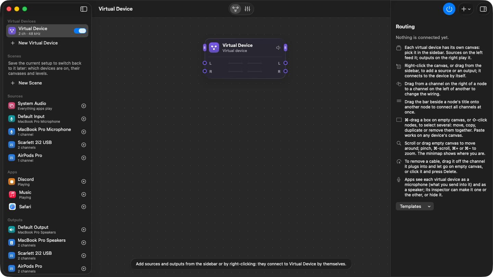
</picture>

Click the device on the canvas to see its settings in the inspector:

<picture>
  <source media="(prefers-color-scheme: light)" srcset="screenshots/device-light.png">
  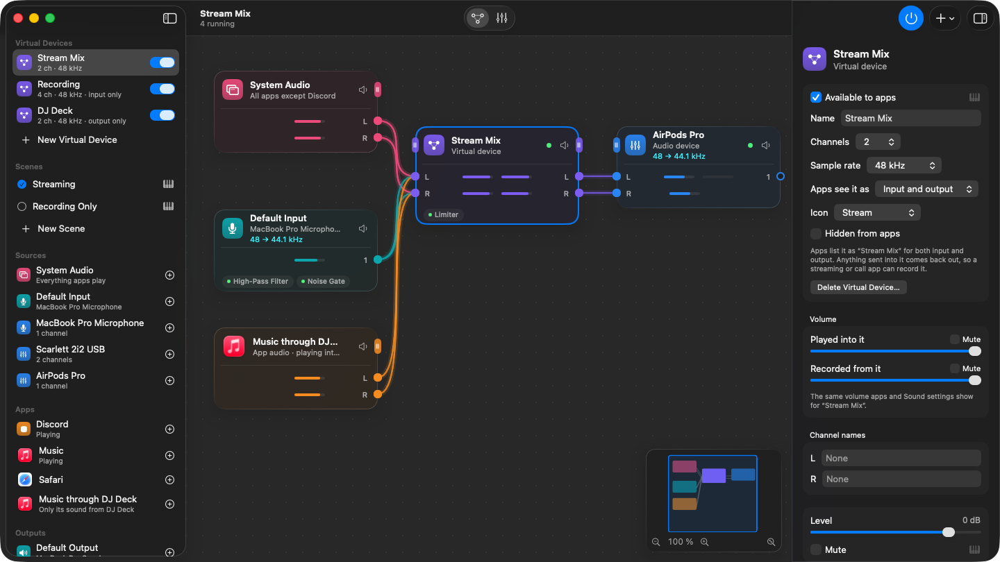
</picture>

- **Available to apps**: when off, apps don't see the device (the sidebar switch does the same).
- **Name**: what apps call it. Pick something you'll recognise in OBS or Discord, like "Stream Mix".
- **Channels**: 2 is stereo. Use more to keep things apart, for example 4 channels with your mic on 1–2 and a call
  on 3–4.
- **Sample rate**: 48 kHz suits streaming and video. Devices running at another rate are converted (see
  "Sample rates" in section 7), so you don't have to match them.

In other apps the device appears under its name, both as a microphone (what Junction sends into it) and as a
speaker. Anything an app plays into it comes back out of it too. Below those settings:

- **Apps see it as**: **Input and output** (the default), **Input only** (apps list it as a microphone only, for a
  recording or call app) or **Output only** (apps list it as a speaker only, for an app you want to capture). Inside
  Junction its canvas works the same either way. Apps that had picked it keep it after a change; macOS may take a
  moment to update their lists.
- **Icon**: the picture Audio MIDI Setup and some apps show for it.
- **Hidden from apps**: leaves it out of every app's device list; Junction still routes it. Handy for a device you
  only use between Junction canvases or for monitoring.
- **Volume**: one slider and **Mute** per side apps see: what is played into it and what is recorded from it. These
  are the same controls Sound settings and the keyboard volume keys change (when the device is the Mac's output), so
  a change made there shows up here too.
- **Channel names**: name the channels (for example "Voice" and "Chat L"). The names show on the canvas and in apps
  that list channels, such as Audio MIDI Setup and DAWs.

The sidebar shows "input only", "output only" or "hidden" under a device's name, and right-clicking a device offers
the same choices.

To delete a device, right-click it in the sidebar and choose **Delete Virtual Device…**. Its canvas goes with it.

## 5. Feed it and listen to it

Add things to the canvas you're looking at in any of these ways:

- click **⊕** next to an item in the sidebar (or double-click the item);
- **drag** an item from the sidebar onto the canvas. It lands where you let go;
- use the **+** menu in the toolbar;
- **right-click** an empty spot on the canvas. The new item lands where you clicked.

A new item is **connected to the device straight away**: sources into it, outputs out of it.

Drop an item **on a cable** to put it on that cable's channels: a source dropped on the cables into the device feeds
the same device channels, and an output dropped on the cables out of the device plays the same channels. Dragging an
item that has no cables yet onto a cable does the same. When the rules don't allow it (an output dropped on a cable
into the device, or a connection that would feed the device back into itself), the item is connected the usual way
and the bottom of the canvas says why. Dragging the canvas's own device from the sidebar moves it to where you let
go; other virtual devices can't be dropped there, because devices never feed each other.

| Source | What it carries |
| --- | --- |
| System Audio | Everything apps play, except the apps you leave out (and Junction itself) |
| An app | That one app's sound, including its helper processes |
| Default Input | The microphone chosen in System Settings › Sound, following any change you make there |
| A microphone or interface | That device's input channels |
| *App* through *device* | What one app plays into one of your other virtual devices, on its own (see below) |

| Output | Why you'd add one |
| --- | --- |
| Default Output | Hear the device on whatever System Settings › Sound plays through |
| Headphones, speakers, an interface | Hear the device on that particular device |

### An app through another virtual device

When an app plays **into one of Junction's virtual devices** (you picked that device as the app's output, for
example a "DJ Deck" speaker for your music player), the sidebar's **Apps** section and the **+** menu also offer
**"Music through DJ Deck"**: only that app's sound, as it plays it into that device, before the device mixes it with
everything else. Add it to another device's canvas like any source. It is offered on every canvas except that
device's own, and only while the app is playing into the device; when the app stops, the node says "Not playing into
DJ Deck" and its cables turn dashed until it plays again.

This needs the Junction driver and **Junction Driver Installer** (allowed in System Settings › General › Login Items &
Extensions; see section 16): the driver keeps each app's sound in a buffer of its own and the installer hands it to
Junction only. The standard Junction doesn't use the installer yet, so there the node shows why it hears nothing.

You don't need an output for a device that another app records (like OBS): add one only when you want to listen
to it yourself. If apps already play on those headphones, you may hear some sounds twice.

Several devices can use the same source: add it to each canvas. Here a second device, "Recording", keeps the mic on
channels 1–2 and Discord on 3–4, so a recording app gets them as separate tracks:

<picture>
  <source media="(prefers-color-scheme: light)" srcset="screenshots/second-canvas-light.png">
  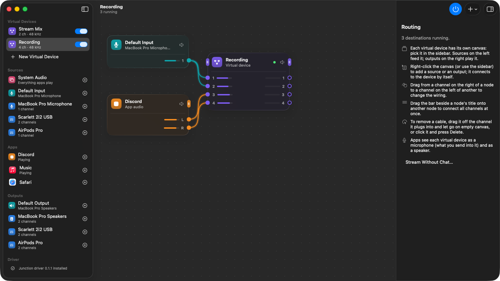
</picture>

## 6. Change the wiring

Each cable joins a channel on the right of one item to a channel on the left of another.

- **Add a cable**: drag from a channel dot on the right side of a node to a channel dot on the left side of another.
- **Connect all channels at once**: drag the small bar beside a node's title onto the other node.
- **Move a cable**: grab it where it plugs in (the dot on the left side of the node it goes into) and drop it on
  another channel.
- **Remove a cable**: grab it the same way and let go on empty canvas. The cable turns red while it's over empty
  space. You can also click a cable and press Delete.
- **Unplug one source or output**: right-click the device and choose **Disconnect** › the item. Right-clicking any
  other item gives a plain **Disconnect** that unplugs just that item.
- **Remove an item** from the canvas: right-click it › **Remove from Canvas**, or select it and press Delete.

Every cable goes into the canvas's device or out of it. Junction refuses anything else and tells you why at the
bottom of the canvas.

### Select, copy and tidy up

- **Select several items**: hold ⌘ and drag a box over empty canvas (⇧-drag adds to the selection), or hold ⇧ and click items to add or take them out of the
  selection. ⌘A selects everything on the canvas. Drag any selected item to move them all; the inspector lists them.
- **Copy, cut, paste and duplicate** (Edit menu, or right-click an item): copied items take the cables between them
  along, including their cables to and from the device. Paste onto the same canvas, or pick another device in the
  sidebar and paste there: the cables then plug into that device. Cables that wouldn't be allowed there (a channel
  the device doesn't have, or one that would feed a device back into itself) are left out. **Duplicate** (⌘D) copies
  and pastes in one step. The device itself is never copied; each canvas has just its own.
- **Delete** removes every selected item and its cables. The device stays: delete it from the sidebar.
- **Tidy Up** (Edit menu, ⌃⌘T, or right-click the canvas) lines the canvas up: sources on the left, the device in the
  middle, outputs on the right, none on top of another.
- **Undo and redo** (⌘Z, ⇧⌘Z) take back any change to canvases and virtual devices: adding, moving, wiring, levels,
  device settings, even deleting a device. The Edit menu names the step. Turning routing on or off isn't undone.

<picture>
  <source media="(prefers-color-scheme: light)" srcset="screenshots/multi-select-light.png">
  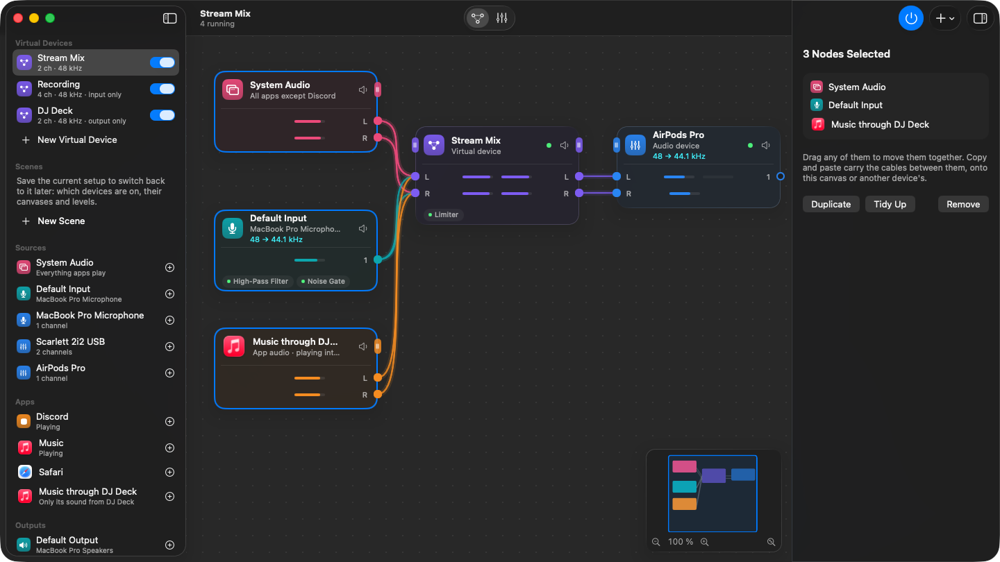
</picture>

### Zoom and move around

- **Zoom** with a pinch on the trackpad, ⌘-scroll, or **View › Zoom In / Zoom Out** (⌘+ and ⌘−). Pinching and
  ⌘-scrolling zoom about the pointer; the menu zooms about the middle of the canvas. **Actual Size** (⌘0) goes back
  to 100 %, and **Zoom to Fit** (⌥⌘0) shows every item.
- **Move around** by scrolling, or by dragging empty canvas. To draw a selection box instead, hold ⌘ (or ⇧ to add to
  the selection) while you drag.
- The **minimap** in the bottom right corner shows the whole canvas and frames the part you're looking at. Click or
  drag in it to move there; its buttons zoom out, back to actual size (the percentage), in, and to fit. **View ›
  Hide Minimap** puts it away.

<picture>
  <source media="(prefers-color-scheme: light)" srcset="screenshots/zoomed-light.png">
  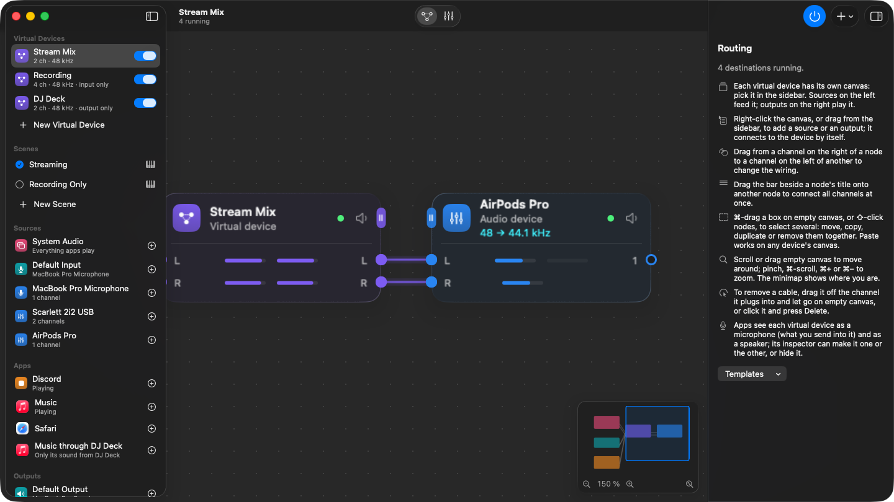
</picture>

### Keyboard and VoiceOver

Every item, channel, cable and meter on the canvas has a VoiceOver label: an item says what it is, how many channels
and cables it has and whether it is muted or running; a channel says what it is connected to; a cable says where it
runs and its level; a meter reads its level in dB.

To **connect from the keyboard**: select an item and press → (or Return) to reach its first output, or ← for its
first input. ↑ and ↓ move through the channels, ← and → switch sides. Press **Return** on a channel to list every
channel it may connect to, pick one with ↑ and ↓, and press **Return** again to connect. Escape closes the list, or
takes you from the channels back to the canvas. With VoiceOver, the channel's action (VO-Space) opens the same list.

## 7. Levels and muting

Select an item or a cable to see its level in the inspector:

<picture>
  <source media="(prefers-color-scheme: light)" srcset="screenshots/cable-light.png">
  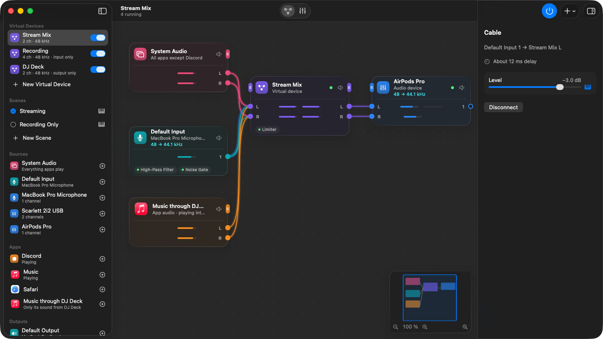
</picture>

- **Level** on an item changes everything it sends (for a source) or receives (for an output).
- **Level** on a cable changes just that cable, so you can turn the mic down in one device only.
- **Reset** a fader to 0 dB: Option-click or Command-click it (double-click works too).
- **Mute**: the speaker icon on a node, or **Mute** in the inspector.

What the canvas shows:

- The bars inside each node are **level meters**.
- Cables **glow** with the sound they carry.
- **Dashed** cables carry nothing right now: routing is off, the device is turned off, a device is unplugged, or
  the cable would cause a loop.
- A **green dot** on a node means it's running. A **yellow triangle** means there's a problem: hover over it, or select
  the node to read it in the inspector. If something fails to start, Junction tries again by itself, and the node
  says why and when.

### Effects

Every item has an **Effects** box in its inspector. Click **Add Effect** and pick one:

<picture>
  <source media="(prefers-color-scheme: light)" srcset="screenshots/effects-light.png">
  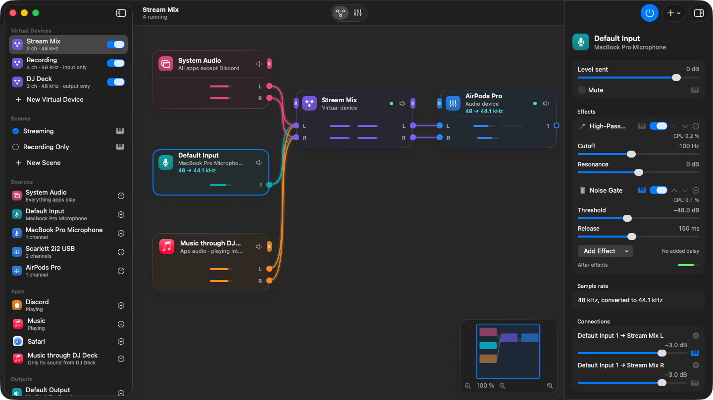
</picture>

- **Built in**: **Gain** (a level), **Pan** (moves a stereo source left or right), **Mono** (both sides get the same
  sound) and **Noise Gate** (silences everything below its threshold, such as a quiet hum or keyboard noise between
  words).
- **Audio Units** from macOS: **High-Pass Filter** (removes rumble below its cutoff), **Equalizer** (low, mid and high
  bands), **Compressor** (evens out loud and quiet parts) and **Limiter** (stops peaks going over the top).

Where the effects work depends on the item:

- On a **source**, they process it before it is mixed into the device: a high-pass filter and a noise gate on a
  microphone, for example.
- On the **virtual device**, they process the mix before it goes into the device, so the apps recording it hear them:
  a limiter on a stream mix, for example. They don't change what apps play into the device directly.
- On an **output**, they process what it receives.

Effects run from top to bottom. Each one has a switch to turn it off for a moment (bypass), arrows to move it up or
down, and a remove button; double-click a slider to put it back to its default. The meters under the list show the
levels after the effects (the meters on the canvas do too). Some effects, such as the limiter, look ahead and add a
little delay: the box says how much, and the delay under **Delay** includes it. Effects are saved with the setup and
with scenes, and they keep working when Junction routes in the background.

On the canvas, an item with effects lists them under its channels, in order: a green dot when an effect is on, struck
through when it's bypassed. Click one to bypass it or turn it back on. When they don't all fit, the names get shorter,
then the last ones show as **+2** (or the item says **4 effects**): click that to select the item and see them all in
the inspector.

Under each effect the box shows what it costs while it runs: how much of the Mac's processor it uses ("CPU 1.2 %"),
the delay it adds, and "own process" for a plugin macOS runs on its own.

### Calibration (headphones)

**Calibration** makes headphones (or speakers) sound flat, or follow a curve you prefer. It is offered under **Add
Effect** on outputs only: headphones, speakers, an interface's playback channels and **Default Output**.

<picture>
  <source media="(prefers-color-scheme: light)" srcset="screenshots/calibration-light.png">
  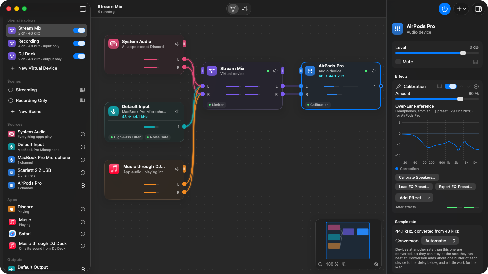
</picture>

1. Select the output in the canvas and choose **Add Effect › Calibration**. Until a correction is loaded it lets the
   sound through unchanged.
2. Click **Load EQ Preset…** and pick a parametric EQ preset for your headphone model: a text file with a line such as
   `Preamp: -6.2 dB` and lines such as `Filter 1: ON PK Fc 105 Hz Gain 5.8 dB Q 0.70`. Peaking (PK) and shelving
   (LS, HS, LSC, HSC) filters are read; a file with other filter types is refused and says which line. The preset is
   kept with your setup, so you don't need the file afterwards.
3. The box shows the preset's name, that it's for headphones, the date you loaded it and the device it was loaded
   for, and a graph of the correction from 20 Hz to 20 kHz. **Amount** sets how much of it you hear: 100 % is the
   whole correction, 50 % half of every boost and cut, 0 % none.

A correction is made for one device. When the output plays on another one (for example **Default Output** after you
pick other headphones in Sound settings), the box warns you; load the preset for those headphones instead. **Export
EQ Preset…** saves the correction (at full amount) as a text file in the same format, to use elsewhere or keep. A
speaker correction with different filters per channel asks which channel to export.

Calibration adds no delay, works on every channel of the output (a correction made per channel works on those
channels and leaves the others alone), and is switched off, moved and controlled by MIDI like any other effect.

### Audio Unit plugins

Any effect Audio Unit installed on your Mac (from another maker, or one of Apple's not listed above) can join a chain.
Choose **Add Effect › Audio Unit…**: the list shows every installed effect by maker. Type in the search field to
narrow it down by name or maker, then pick one and click **Add** (or double-click it).

<picture>
  <source media="(prefers-color-scheme: light)" srcset="screenshots/plugin-picker-light.png">
  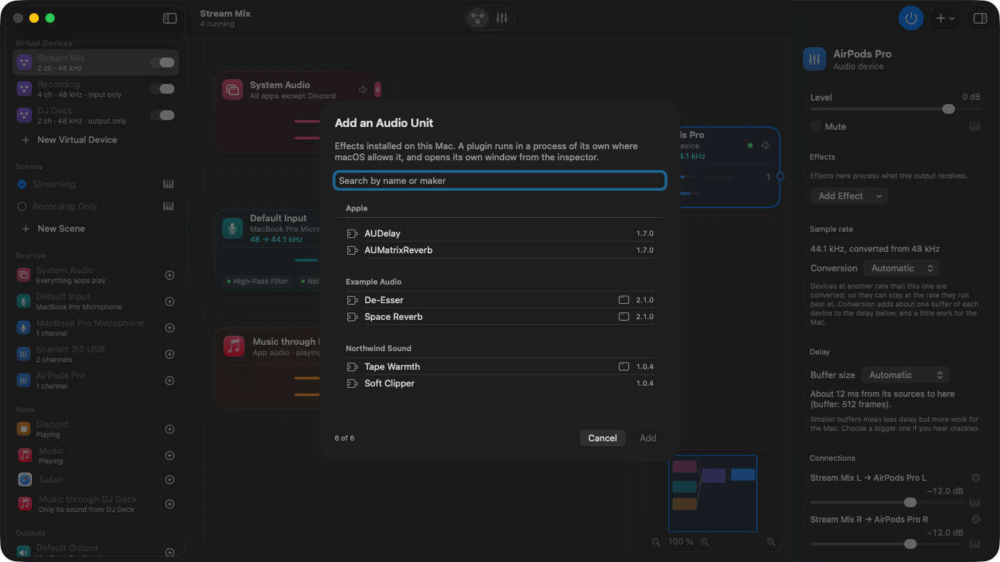
</picture>

- **Open Window** shows the plugin's own controls (or a slider for each setting when it has no window of its own).
  The window belongs to whatever routes: Junction itself, or **Junction Helper** when routing runs in the background,
  so it can appear in front of Junction as another app. It opens while the plugin runs (routing on, its item
  connected). Whatever you change there is saved with your setup.
- Where macOS allows it, a plugin runs in a **process of its own**: if it crashes, the sound passes through it
  unprocessed instead of stopping Junction.
- A plugin that keeps **holding up the audio** (it takes more than half of the time each buffer lasts, three times
  within ten seconds) is flagged in its box with **Bypass** and **Keep Running**. Bypass it if you hear dropouts.
  The virtual device's or output's **Delay** box counts **overloads**: buffers its routing didn't finish in time.
- If a plugin is **missing** (removed, or the setup came from another Mac), its box says so, the sound passes through
  it, and its settings stay in the setup, so it works as before once it is installed again.

<picture>
  <source media="(prefers-color-scheme: light)" srcset="screenshots/missing-plugin-light.png">
  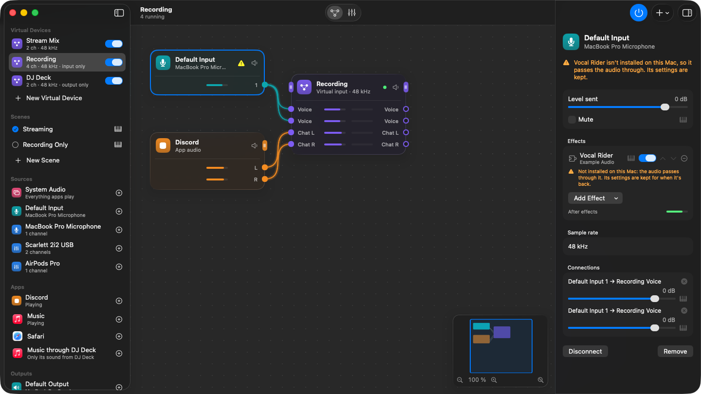
</picture>

### Delay and buffer size

A selected cable shows roughly how long sound takes to travel through it. Select the virtual device or an output to
change its **Buffer size** under **Delay**. Smaller buffers mean less delay but more work for the Mac. If you hear
crackles, choose a bigger buffer. **Automatic** leaves the choice to macOS.

### Sample rates

Device nodes show the rate they run at, for example "Scarlett 2i2 USB · 48 kHz". When a device runs at another rate
than the virtual device it feeds or plays, Junction converts between the two and the node says so on a line of its own: a
source shows "44.1 kHz, converted to 48 kHz", an output "44.1 kHz, converted from 48 kHz". Conversion keeps the
pitch right and follows the small differences between two devices' clocks. It adds a little delay (under 1 ms for
the filter, plus about one buffer of each device), which the delay shown in the inspector includes.

Select the virtual device or an output to change **Conversion** under **Sample rate**. **Automatic** (the usual
choice) converts any device at another rate. **Off** combines them as they are, as Junction did before conversion
existed: the node then shows a yellow triangle, and you should set both to the same rate in Audio MIDI Setup.

### The mixer

Click **Mixer** in the toolbar (or choose **View › Show Mixer**, ⌘2) to see the device's canvas as a mixing desk.
**Canvas** (⌘1) goes back. Each source has a strip on the left, then the virtual device, then each output:

<picture>
  <source media="(prefers-color-scheme: light)" srcset="screenshots/mixer-light.png">
  
</picture>

- The **fader** is the item's level, and **M** its mute: the same ones as in the inspector. Double-click or
  Option-click a fader for 0 dB.
- **Pan** appears where the item's cables reach both a left and a right channel (a source into the device's channels
  1 and 2, an output's channels 1 and 2). It turns down the cables on one side, so you'll see their levels change on
  the canvas too. Double-click it to center.
- The **meters** show what the item sends (sources, the device) or receives (outputs).
- The **effects** box lists the chain: click an effect to bypass it or turn it back on, and **Add** to add one. Click
  the strip's name to edit the effects' settings in the inspector.

Everything you change in the mixer changes the canvas, and the other way round, with the same undo.

### Headphone monitor and solo

The **Monitor** strip on the right is a separate mix for your headphones. Choose where it plays from its menu
(headphones, speakers, or Default Output; never one of Junction's own devices). It plays the device's sources as
they are wired into it, at **levels of its own**: the headphone button and slider at the bottom of each source strip.
Those levels apply before the source's fader and mute, so you can turn your microphone down or mute it in the stream
and still hear it, or leave the music out of your headphones while the stream keeps it. The monitor has its own
fader, mute and meters. It hears sources before their effects.

**S** (solo) on any strip sends just that item to the monitor instead of its mix: a source, the device's own sound
(what apps recording it hear), or what an output receives. You can also right-click any channel on the canvas and
choose **Listen on Monitor** to hear that one channel alone. Solo and listen never change the device's mix or what
your outputs play. Click **S** again, or **Stop Listening** in the Monitor strip, to go back to the monitor's mix.
Solo isn't kept when Junction restarts, and scenes don't change the monitor.

## 8. Leave apps out

Select a **System Audio** node to see its **Leave out** list in the inspector.

- **Leave Out an App** lists the apps using sound right now and the chat apps installed on your Mac.
- **Choose App…** picks any other app from your Applications folder.
- Remove an app from the list with the **⊖** button next to it.

Junction keeps the list up to date as apps start and quit, so a chat app opened after routing started is left out
too.

**Only through Junction** (on System Audio and app nodes) takes that sound away from your speakers while Junction
captures it, so you hear it only where you route it.

## 9. Stream without your voice chat (OBS and Discord)

<picture>
  <source media="(prefers-color-scheme: light)" srcset="screenshots/stream-template-light.png">
  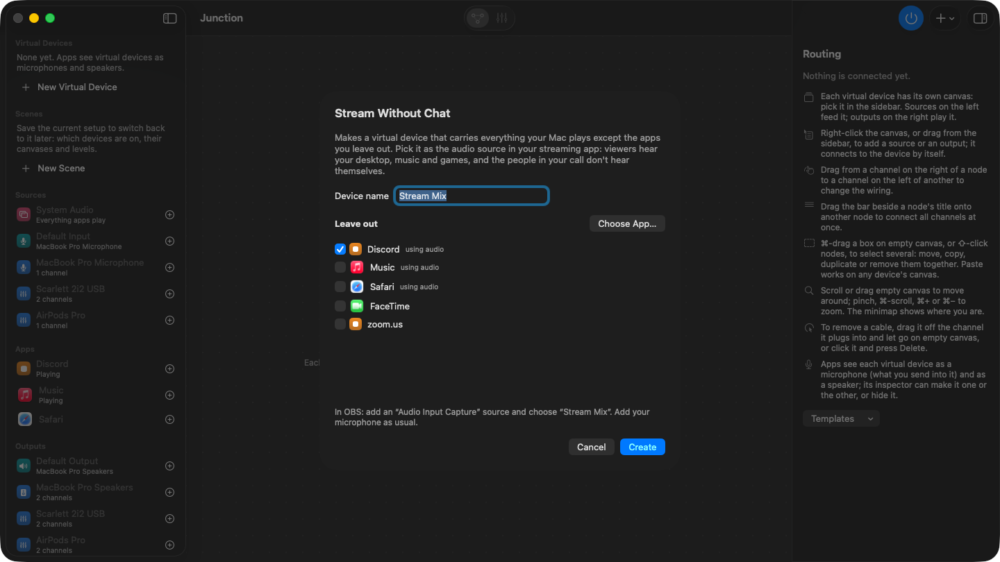
</picture>

1. Choose **Stream Without Chat…** (File menu, the **+** menu, or the **Templates** menu on the empty canvas).
2. Keep the name **Stream Mix** (or pick your own), tick your chat app (Discord is ticked if it's installed), and
   click **Create**. You get a "Stream Mix" device fed by System Audio with your chat app left out.
3. In **OBS**: add an **Audio Input Capture** source and choose **Stream Mix**. Remove or mute any other
   desktop-audio source in OBS, or the desktop will be recorded twice. Add your microphone in OBS as usual.
4. In **Discord**: nothing changes. Keep your usual microphone and headphones.

Check it: play a video and talk on Discord. OBS's meter for Stream Mix should move with the video, not with the
voices from Discord.

## 10. Podcast, DAW and call templates

Next to **Stream Without Chat…** (File menu, the **+** menu, and the **Templates** menu on the empty canvas and in the
inspector) are three more templates. Each makes a virtual microphone, a device apps see as an input only, and wires it
on its canvas. Choosing the same name again reuses that device (and turns it on).

<picture>
  <source media="(prefers-color-scheme: light)" srcset="screenshots/podcast-template-light.png">
  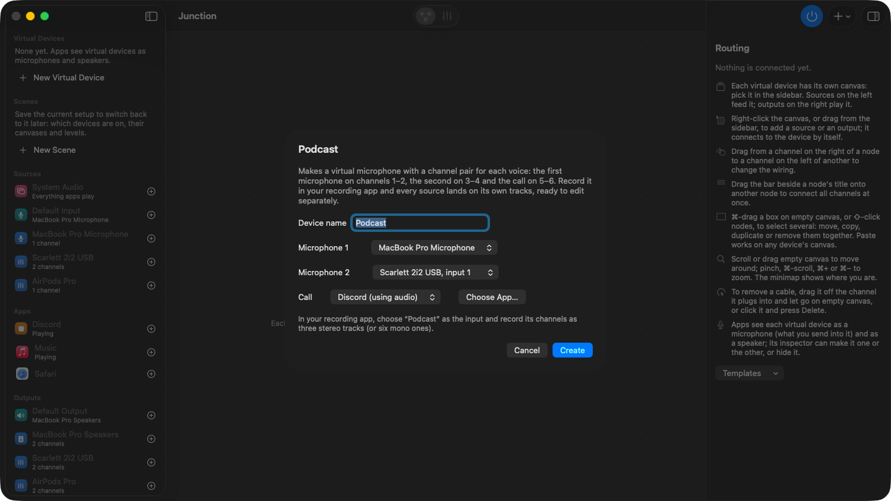
</picture>

- **Podcast…**: pick two microphones (any input of any device, or the default input) and the call app. Each gets a
  channel pair of its own on the **Podcast** device: microphone 1 on channels 1–2, microphone 2 on 3–4, the call on
  5–6, with the channels named to match. In your recording app choose **Podcast** as the input and record three
  stereo tracks, so every voice can be edited on its own. Leave a microphone or the call at **None** to skip it.
- **DAW into a Call…**: pick your music app and, if you want to talk over it, a microphone. The **DAW to Call**
  device carries what the music app plays; choose it as the microphone in the call app, and turn off the call app's
  noise suppression and echo cancellation so music comes through. You keep hearing the music app as usual.

<picture>
  <source media="(prefers-color-scheme: light)" srcset="screenshots/daw-into-call-template-light.png">
  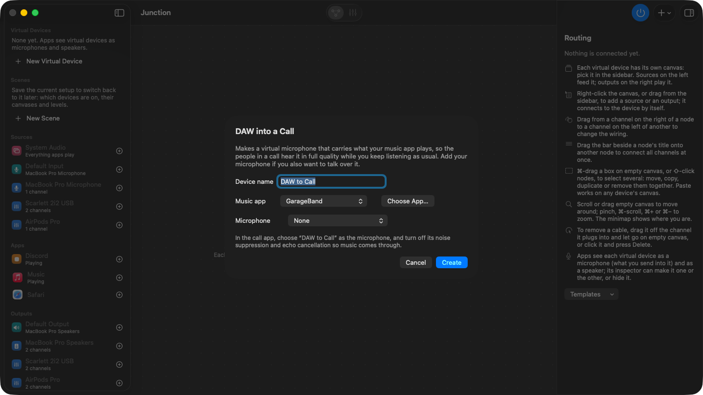
</picture>

- **Call into the DAW…**: pick the call app. The **Call to DAW** device carries the call's audio; choose it as an
  input in your music app and record channels 1–2 on a stereo track.

<picture>
  <source media="(prefers-color-scheme: light)" srcset="screenshots/call-into-daw-template-light.png">
  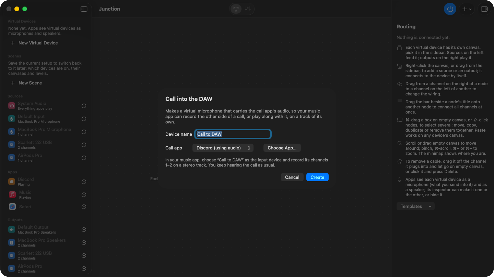
</picture>

The apps on offer are the ones using audio now and the known chat or music apps installed on your Mac; **Choose
App…** picks any other.

## 11. Scenes

A scene remembers a whole setup so you can come back to it in one step: which virtual devices are on, their volumes
and mutes, and every canvas with its nodes, cables, levels and mutes. Use one per show, session or room.

<picture>
  <source media="(prefers-color-scheme: light)" srcset="screenshots/scene-menu-light.png">
  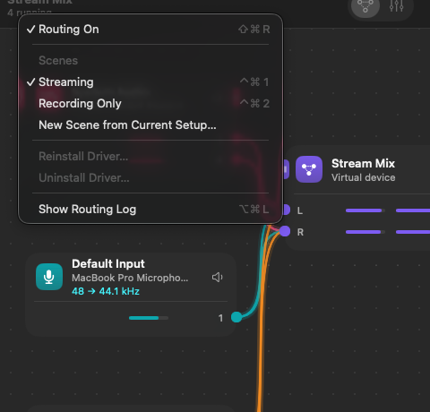
</picture>

- **Save one**: **Routing › New Scene from Current Setup…**, or **New Scene** in the sidebar's **Scenes** section.
  Give it a name and click **Save**.
- **Switch**: choose it in the **Routing** menu (the first nine also with ⌃⌘1…⌃⌘9), in the **menu bar** icon's menu,
  or click it in the sidebar. The scene you are in is checked; once you change something, none is.
- **Change one**: right-click it in the sidebar for **Update from Current Setup**, **Rename…** and **Delete Scene**.
  Switching, saving, renaming and deleting can all be undone (⌘Z).

Switching changes only what differs. A destination whose wiring is the same in both scenes keeps playing and just
takes the scene's levels; the ones that change are rebuilt next to the running ones and cross-faded, without a gap.
Turning a device off in a scene takes it away from apps while that scene is on.

Scenes don't change a device's name, channels, sample rate or direction. A virtual device made after a scene stays as
it is when you switch to that scene; deleting a device removes it from every scene.

## 12. MIDI controllers

Any MIDI controller can work Junction's levels and switches: faders, knobs, endless encoders, buttons, pads and keys,
and program changes. Plug it in (USB, Bluetooth or a network session) and map its controls with **MIDI Learn**:

1. Click the **keyboard button** (a small piano keyboard) beside what you want to control:
   - a **cable's level** (in the cable's inspector, or beside each connection in a node's inspector),
   - a node's **Mute**,
   - an effect's switch, to **bypass** it,
   - a virtual device's **Available to apps** switch,
   - or, for a **scene**, right-click it in the sidebar and choose **Learn MIDI Control**.
2. A banner above the canvas asks you to move a control. Turn a knob, push a fader, press a pad or send a program
   change: that control now drives it, and the keyboard button is highlighted (point at it to see which control). **Cancel** (or Esc) stops listening.

<picture>
  <source media="(prefers-color-scheme: light)" srcset="screenshots/midi-learn-light.png">
  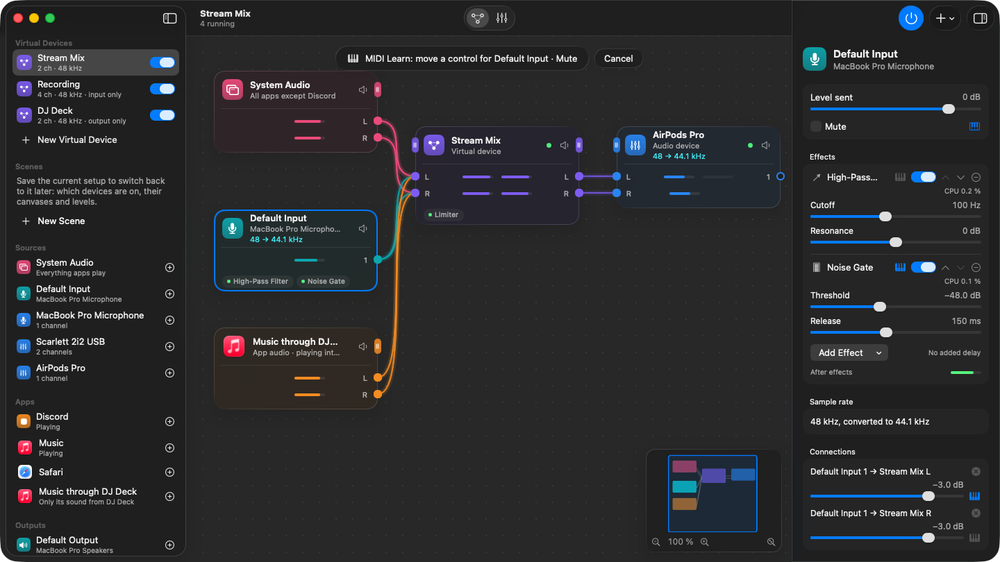
</picture>

How controls behave:

- **Levels** take faders, knobs and endless encoders. A fader or knob **picks up** the level first: if it isn't where
  the level is, moving it does nothing until it reaches (or passes) the level, so the sound never jumps. The same
  happens after you change the level on screen. Two thirds of the way up (100 of 127) is 0 dB; the top is +12 dB, the
  bottom silence. An encoder nudges the level by 0.5 dB a step from wherever it is.
- **Mutes, bypasses and device switches** flip with each press of a button, pad or key, or with a program change.
  Read as a knob, the top half is on (muted, bypassed, available) and the bottom half off; an encoder turned up turns
  it on, down off.
- **Scenes** switch on a press, a key, a program change, or a knob passing halfway.

Learning another control for the same thing replaces the old one. The keyboard button's right-click menu forgets a
mapping.

**Settings › MIDI** lists the controllers Junction hears and every mapping, with what it drives and the control that
drives it. For each knob or fader you can choose how its values are read: **Knob or fader**, **Button**, or one of the
three kinds of **encoder** (endless encoders send different values for up and down; if yours moves the wrong way or in
big jumps, try another). The **−** button removes a mapping; Undo (⌘Z) brings it back.

<picture>
  <source media="(prefers-color-scheme: light)" srcset="screenshots/midi-settings-light.png">
  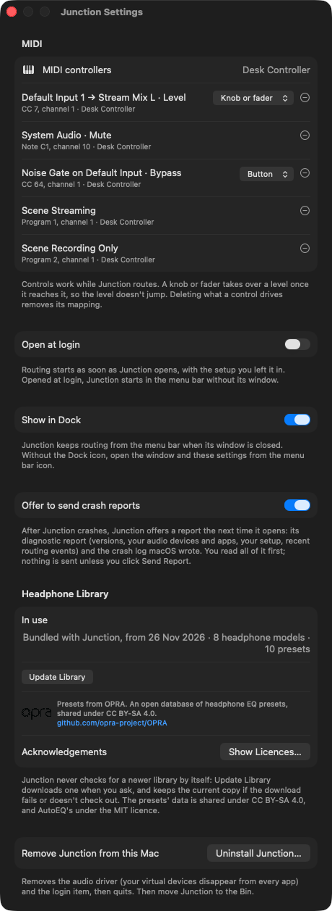
</picture>

MIDI works wherever routing runs: with **Keep routing after quitting Junction** on (section 13), your controller keeps
working after you quit Junction, and Junction finds the changes when you open it again. Deleting a node, cable, effect,
device or scene removes the mappings that drive it, unless a scene still holds it: then the mapping works again once
you switch to that scene. Moving a control isn't an undo step (the controller still shows where it is); learning one
is.

## 13. Turning routing on and off

- The **power button** in the toolbar, **Routing › Routing On** (⇧⌘R), or the **menu bar icon** turn all routing on
  or off. When it's off, your virtual devices still exist but stay silent.
- **Closing the window** keeps routing going from the menu bar. **Quitting** Junction stops it, unless routing runs in
  the background with **Keep routing after quitting Junction** on (see below).
- The menu bar icon also switches scenes and each virtual device on or off, and offers driver updates.
- **Junction › Settings…** (also in the menu bar icon's menu) has **Open at login**, so routing is ready after a
  restart (Junction then starts in the menu bar, without its window), and **Show in Dock**: turn it off to keep
  Junction in the menu bar only. It also turns crash reports on (section 17) and uninstalls Junction (section 16); in
  a Junction built with its driver installer, it shows whether the driver installs without a password (section 2). Its
  **MIDI** section lists your MIDI mappings (section 12).

### Routing in the background

The standard Junction routes by itself, and routing stops when it quits. A Junction built for it (not yet the
standard one) routes in **Junction Helper** instead, a small helper inside Junction with no Dock icon or window.
Settings then shows **Routing runs in the background**. You don't need to do
anything: Junction starts the helper when it needs it and sends it every change you make.

- **Keep routing after quitting Junction** (Settings): with it on, your devices keep their sound after you quit
  Junction, and routing starts again when you log in, even before you open Junction. With it off (the standard
  setting), routing stops when you quit Junction, as before.
- macOS lists the helper in System Settings › General › **Login Items & Extensions**, under **Allow in the
  Background**, as Junction. **To turn the helper off**, switch Junction off there. Junction then routes by itself
  and stops routing when it quits; Settings says **Routing runs inside Junction** and offers **Open Login Items** to
  switch it back on.
- Permissions belong to the helper: macOS asks for **Junction Helper**, and lists it under Microphone and Screen &
  System Audio Recording. The banners and hints name it too.

If you build Junction yourself, routing runs inside Junction unless you build with `ROUTING_HELPER=1`, and the driver
installs with your password unless you build with `DRIVER_DAEMON=1`.

## 14. Permissions

macOS asks for two permissions the first time Junction needs them. They belong to the process that routes:
**Junction**, or **Junction Helper** when routing runs in the background (see section 13). The prompts and banners
say which.

- **Microphone**: to read any input, including Junction's own virtual devices.
- **System Audio Recording**: for System Audio and app nodes.

If you said no:

- **Microphone**: a banner at the top of the canvas says so. Click **Open System Settings** and turn Junction (or
  Junction Helper) on. Routing starts again by itself.
- **System Audio Recording**: macOS doesn't tell apps whether this one is allowed. If an App or System Audio item
  hears nothing while the apps it captures are playing, it shows a yellow triangle. Select it and click **Open
  Privacy Settings…**, then turn Junction (or Junction Helper) on under **Screen & System Audio Recording**.

If you build Junction yourself, macOS may ask again after each rebuild.

## 15. No feedback loops

Sending a device's sound back into itself would make it ring louder and louder. Junction prevents that:

- a device can't be connected into itself;
- virtual devices never feed each other: each one has its own canvas;
- a device can't go to **Default Output** while System Settings › Sound plays through that same device, or take
  **Default Input** while that's the same device;
- an app *through* a device counts as that device's sound: "Music through DJ Deck" can't go into DJ Deck, nor into a
  device that already feeds DJ Deck;
- a headphone monitor never plays into one of Junction's devices: if Sound settings point Default Output at one, the
  monitor stops and says why in its strip.

If you change Sound settings later in a way that would close a loop, Junction stops using that cable (it turns
dashed) and explains why on the node.

## 16. Updating or removing the driver

- When a new Junction comes with a newer driver, the sidebar and the menu bar show **Driver update available** with
  both version numbers. Click **Update Driver…**: your password, then a short silence while audio restarts.
  Routing starts again by itself.
- An older copy of Junction tells you a newer driver is installed and doesn't offer to replace it.
- To remove the driver: **Routing › Uninstall Driver…**. Your virtual devices disappear from all apps.

Once Junction's driver installer is allowed in Login Items (section 2), installing, updating and removing the driver
don't ask for your password. If the installer refuses (for example because the driver inside Junction isn't signed
like Junction), Junction says why and installs nothing; download Junction again.

### Uninstall Junction

**Junction › Settings… › Uninstall Junction…** removes everything Junction added to your Mac: the audio driver (your
virtual devices disappear from all apps, and sound stops for a moment) and the login item, and Junction Helper and the
driver installer in a Junction built with them. Choose:

- **Uninstall and Keep My Setup**: your devices, canvases and scenes stay, ready if you install Junction again.
- **Uninstall and Remove My Setup**: they go too, with Junction's settings.

Junction then quits. Move Junction to the Bin to finish.

Junction itself updates through **Junction › Check for Updates…** (also in the menu bar menu). The second time you
open it, Junction asks whether to check automatically. Updating the app doesn't touch the driver; a new driver, when
there is one, is offered as above.

## 17. Troubleshooting

| Problem | Try this |
| --- | --- |
| OBS hears nothing from the device | Is routing on (power button)? Is the device switched on in the sidebar? Are its cables solid, not dashed? Check both permissions (section 14). |
| My voice chat is still on stream | Select System Audio and check that the chat app is in its **Leave out** list. Safari and other apps built on Safari share one process, so they can only be left out together. |
| I hear things twice | An output on the device's canvas plays the device on top of what apps already play there. Remove the output, or use headphones that apps don't play on. |
| Crackles or odd pitch | Crackles usually mean the buffer is too small: select the device or output and choose a bigger **Buffer size**. A node with a yellow triangle about sample rates is combined without conversion: select the virtual device or output it is wired to and set **Conversion** to **Automatic**, or set both devices to the same rate in Audio MIDI Setup. |
| A node says "converted to 48 kHz" | That device runs at another rate than its virtual device, and Junction converts it. Nothing to do; to avoid the small extra delay, set both to the same rate in Audio MIDI Setup. |
| Converted sound drops out for a moment | The device stopped delivering sound in time (a busy Mac, or a device that paused), so Junction faded it out and back in rather than click. A bigger **Buffer size** helps; the Routing Log shows rebuilds if the device stopped altogether. |
| Dropouts since adding a plugin | Look at the plugin's box: "holding up the audio" means it takes too long; click **Bypass**, choose a bigger **Buffer size**, or try another plugin. The **Delay** box of the device or output counts overloads. |
| A plugin's window doesn't open | It opens while the plugin runs: turn routing on and connect its item. With routing in the background the window belongs to Junction Helper and may be behind other windows. |
| The volume keys don't change a virtual device | Virtual devices have no volume control yet; use the level faders in Junction. |
| A device or interface shows "Not connected" | It's unplugged or off. Its cables come back to life when it returns. |
| A virtual device switched sample rate on its own | Other apps (Audio MIDI Setup, a DAW) can set it, and macOS restores the last rate it remembers. Junction follows such changes; set the rate you want in the inspector. |
| Something stops or comes back on its own | Open **Routing › Show Routing Log** (⌥⌘L). It lists what Junction started, rebuilt or retried, and why. |

To report a problem, open the Routing Log and click **Copy Report**, then paste it into your report. It lists your
Junction and macOS versions, your audio devices and apps, your setup and recent routing events. It names your
devices and apps, so read it before sharing it.

### Crash reports

Crash reports are off until you turn on **Offer to send crash reports** in **Junction › Settings…**. Then, if
Junction or Junction Helper quits unexpectedly, the next time Junction opens it shows the whole report: the same
report as Copy Report, followed by the crash log macOS wrote. Nothing is sent until you have seen it:

- **Send Report** (in the released Junction) sends exactly what you see, and nothing else.
- **Copy Report** copies it, to paste into a bug report yourself. Copies of Junction built from source can only copy.
- **Don't Send** leaves it. Each crash is offered once; crashes from before you turned the setting on never are.

## 18. Shortcuts

| Action | Shortcut |
| --- | --- |
| New virtual device | ⌘N |
| Routing on/off | ⇧⌘R |
| Switch to scene 1–9 | ⌃⌘1 … ⌃⌘9 |
| Show or hide the inspector | ⌥⌘I |
| Show the canvas / the mixer | ⌘1 / ⌘2 |
| Routing Log | ⌥⌘L |
| Settings | ⌘, |
| Delete the selected cable or items | Delete (on the canvas) or ⌘⌫ |
| Undo / Redo | ⌘Z / ⇧⌘Z |
| Cut / Copy / Paste | ⌘X / ⌘C / ⌘V |
| Duplicate the selected items | ⌘D |
| Select everything on the canvas | ⌘A |
| Add an item to the selection, or take it out | ⇧-click |
| Select with a box | ⌘-drag on empty canvas (⇧-drag adds to the selection) |
| Move around the canvas | Scroll, or drag empty canvas |
| Zoom in / out | ⌘+ / ⌘−, pinch, or ⌘-scroll |
| Actual size / Zoom to fit | ⌘0 / ⌥⌘0 |
| From a selected item to its channels | → or Return (outputs), ← (inputs) |
| Move between channels | ↑ ↓ ← → |
| Connect a channel from the keyboard | Return, pick a channel, Return |
| Back from the channels to the canvas | Escape |
| Stop MIDI Learn | Escape (while its banner shows) |
| Tidy Up | ⌃⌘T |
| Reset a fader to 0 dB | Option-click, Command-click or double-click |
| Add something where you click | Right-click the canvas |
| Add something where you drop it | Drag it from the sidebar (onto a cable to put it on that cable) |
| Remove a cable | Drag it off its input onto empty canvas |
