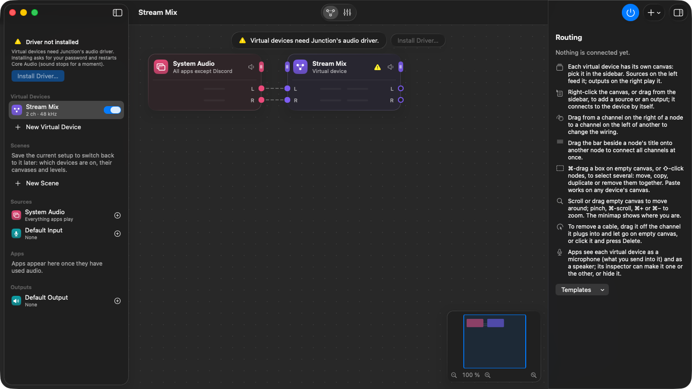
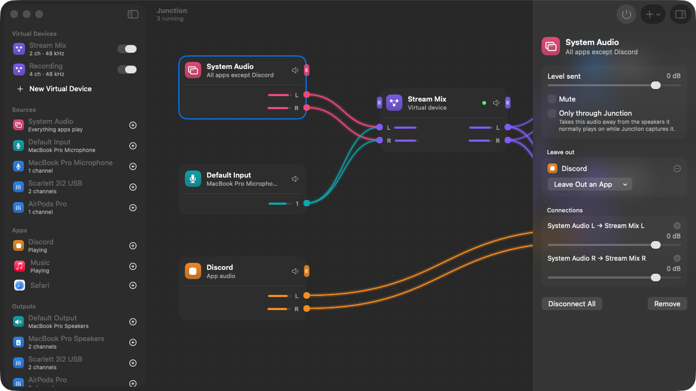

# Junction user guide

Junction makes **virtual audio devices** on your Mac and lets you decide what goes into them. Every app sees a
virtual device as a microphone and as a speaker, so a streaming, recording or call app can pick it up like any other
device. You fill it with whatever you choose: the sound of your Mac, single apps, microphones and audio interfaces.

The most common use: **stream your desktop audio without your voice chat**, so viewers hear your music, games and
videos, and the people you're talking to on Discord don't hear themselves on stream.

**Contents**

1. [Install Junction](#1-install-junction)
2. [Install the audio driver](#2-install-the-audio-driver)
3. [The window at a glance](#3-the-window-at-a-glance)
4. [Make a virtual device](#4-make-a-virtual-device)
5. [Feed it and listen to it](#5-feed-it-and-listen-to-it)
6. [Change the wiring](#6-change-the-wiring)
7. [Levels and muting](#7-levels-and-muting)
8. [Leave apps out](#8-leave-apps-out)
9. [Stream without your voice chat (OBS and Discord)](#9-stream-without-your-voice-chat-obs-and-discord)
10. [Turning routing on and off](#10-turning-routing-on-and-off)
11. [Permissions](#11-permissions)
12. [No feedback loops](#12-no-feedback-loops)
13. [Updating or removing the driver](#13-updating-or-removing-the-driver)
14. [Troubleshooting](#14-troubleshooting)
15. [Shortcuts](#15-shortcuts)

## 1. Install Junction

Junction needs **macOS 26** or newer. There is no download yet: you build it from this repository with
**Xcode 26** installed.

1. Download or clone the repository.
2. In Terminal, inside the repository folder, run `./build.sh`.
3. Open `build/Junction.app` (you can move it to your Applications folder first).

## 2. Install the audio driver

Virtual devices come from a small audio driver that Junction installs into macOS. The first time you open Junction,
the sidebar and the canvas offer **Install Driver…**.

<picture>
  <source media="(prefers-color-scheme: light)" srcset="screenshots/no-driver-light.png">
  
</picture>

- macOS asks for your administrator password.
- All sound on the Mac stops for a moment while macOS's audio system restarts. That is normal.
- After that, your virtual devices exist for every app, even when Junction isn't running (they're silent until
  Junction routes something into them or an app plays into them).

## 3. The window at a glance

<picture>
  <source media="(prefers-color-scheme: light)" srcset="screenshots/canvas-light.png">
  
</picture>

- **Sidebar** (left): your **virtual devices**, each with an on/off switch. Below them, everything you can add:
  **Sources** (System Audio, your input devices), **Apps** that have played sound, and **Outputs** (speakers,
  headphones, interfaces).
- **Canvas** (middle): every virtual device has its own canvas. Click a device in the sidebar to see it. Sources sit
  on the left and feed the device; outputs sit on the right and let you hear it.
- **Inspector** (right): settings and levels for whatever you select. Show or hide it with the button at the top
  right (⌥⌘I).
- **Toolbar**: the power button turns all routing on or off; **+** adds things to the canvas.

## 4. Make a virtual device

Click **New Virtual Device** (in the sidebar, in the **+** menu, or press ⌘N). It gets its own, empty canvas:

<picture>
  <source media="(prefers-color-scheme: light)" srcset="screenshots/new-device-light.png">
  
</picture>

Click the device on the canvas to see its settings in the inspector:

<picture>
  <source media="(prefers-color-scheme: light)" srcset="screenshots/device-light.png">
  
</picture>

- **Available to apps**: when off, apps don't see the device (the sidebar switch does the same).
- **Name**: what apps call it. Pick something you'll recognise in OBS or Discord, like "Stream Mix".
- **Channels**: 2 is stereo. Use more to keep things apart, for example 4 channels with your mic on 1–2 and a call
  on 3–4.
- **Sample rate**: 48 kHz suits streaming and video. Matching the rate of your other devices gives the cleanest
  sound.

In other apps the device appears under its name, both as a microphone (what Junction sends into it) and as a
speaker. Anything an app plays into it comes back out of it too.

To delete a device, right-click it in the sidebar and choose **Delete Virtual Device…**. Its canvas goes with it.

## 5. Feed it and listen to it

Add things to the canvas you're looking at in any of three ways:

- click **⊕** next to an item in the sidebar (or double-click the item);
- use the **+** menu in the toolbar;
- **right-click** an empty spot on the canvas. The new item lands where you clicked.

A new item is **connected to the device straight away**: sources into it, outputs out of it.

| Source | What it carries |
| --- | --- |
| System Audio | Everything apps play, except the apps you leave out (and Junction itself) |
| An app | That one app's sound, including its helper processes |
| Default Input | The microphone chosen in System Settings › Sound, following any change you make there |
| A microphone or interface | That device's input channels |

| Output | Why you'd add one |
| --- | --- |
| Default Output | Hear the device on whatever System Settings › Sound plays through |
| Headphones, speakers, an interface | Hear the device on that particular device |

You don't need an output for a device that another app records (like OBS): add one only when you want to listen
to it yourself. If apps already play on those headphones, you may hear some sounds twice.

Several devices can use the same source: add it to each canvas. Here a second device, "Recording", keeps the mic on
channels 1–2 and Discord on 3–4, so a recording app gets them as separate tracks:

<picture>
  <source media="(prefers-color-scheme: light)" srcset="screenshots/second-canvas-light.png">
  
</picture>

## 6. Change the wiring

Each cable joins a channel on the right of one item to a channel on the left of another.

- **Add a cable**: drag from a channel dot on the right side of a node to a channel dot on the left side of another.
- **Connect all channels at once**: drag the small bar beside a node's title onto the other node.
- **Move a cable**: grab it where it plugs in (the dot on the left side of the node it goes into) and drop it on
  another channel.
- **Remove a cable**: grab it the same way and let go on empty canvas. The cable turns red while it's over empty
  space. You can also click a cable and press Delete.
- **Unplug one source or output**: right-click the device and choose **Disconnect** › the item. Right-clicking any
  other item gives a plain **Disconnect** that unplugs just that item.
- **Remove an item** from the canvas: right-click it › **Remove from Canvas**, or select it and press Delete.

Every cable goes into the canvas's device or out of it. Junction refuses anything else and tells you why at the
bottom of the canvas.

## 7. Levels and muting

Select an item or a cable to see its level in the inspector:

<picture>
  <source media="(prefers-color-scheme: light)" srcset="screenshots/cable-light.png">
  
</picture>

- **Level** on an item changes everything it sends (for a source) or receives (for an output).
- **Level** on a cable changes just that cable, so you can turn the mic down in one device only.
- **Reset** a fader to 0 dB: Option-click or Command-click it (double-click works too).
- **Mute**: the speaker icon on a node, or **Mute** in the inspector.

What the canvas shows:

- The bars inside each node are **level meters**.
- Cables **glow** with the sound they carry.
- **Dashed** cables carry nothing right now: routing is off, the device is turned off, a device is unplugged, or
  the cable would cause a loop.
- A **green dot** on a node means it's running. A **yellow triangle** means there's a problem: hover over it, or select
  the node to read it in the inspector. If something fails to start, Junction tries again by itself, and the node
  says why and when.

### Delay and buffer size

A selected cable shows roughly how long sound takes to travel through it. Select the virtual device or an output to
change its **Buffer size** under **Delay**. Smaller buffers mean less delay but more work for the Mac. If you hear
crackles, choose a bigger buffer. **Automatic** leaves the choice to macOS.

## 8. Leave apps out

Select a **System Audio** node to see its **Leave out** list in the inspector.

- **Leave Out an App** lists the apps using sound right now and the chat apps installed on your Mac.
- **Choose App…** picks any other app from your Applications folder.
- Remove an app from the list with the **⊖** button next to it.

Junction keeps the list up to date as apps start and quit, so a chat app opened after routing started is left out
too.

**Only through Junction** (on System Audio and app nodes) takes that sound away from your speakers while Junction
captures it, so you hear it only where you route it.

## 9. Stream without your voice chat (OBS and Discord)

<picture>
  <source media="(prefers-color-scheme: light)" srcset="screenshots/stream-template-light.png">
  
</picture>

1. Choose **Stream Without Chat…** (File menu, the **+** menu, or the empty canvas).
2. Keep the name **Stream Mix** (or pick your own), tick your chat app (Discord is ticked if it's installed), and
   click **Create**. You get a "Stream Mix" device fed by System Audio with your chat app left out.
3. In **OBS**: add an **Audio Input Capture** source and choose **Stream Mix**. Remove or mute any other
   desktop-audio source in OBS, or the desktop will be recorded twice. Add your microphone in OBS as usual.
4. In **Discord**: nothing changes. Keep your usual microphone and headphones.

Check it: play a video and talk on Discord. OBS's meter for Stream Mix should move with the video, not with the
voices from Discord.

## 10. Turning routing on and off

- The **power button** in the toolbar, **Routing › Routing On** (⇧⌘R), or the **menu bar icon** turn all routing on
  or off. When it's off, your virtual devices still exist but stay silent.
- **Closing the window** keeps routing going from the menu bar. **Quitting** Junction stops it.
- The menu bar icon also switches each virtual device on or off, and offers driver updates.

## 11. Permissions

macOS asks for two permissions the first time Junction needs them:

- **Microphone**: to read any input, including Junction's own virtual devices.
- **System Audio Recording**: for System Audio and app nodes.

If you said no:

- **Microphone**: a banner at the top of the canvas says so. Click **Open System Settings** and turn Junction on.
  Routing starts again by itself.
- **System Audio Recording**: macOS doesn't tell apps whether this one is allowed. If an App or System Audio item
  hears nothing while the apps it captures are playing, it shows a yellow triangle. Select it and click **Open
  Privacy Settings…**, then turn Junction on under **Screen & System Audio Recording**.

If you build Junction yourself, macOS may ask again after each rebuild.

## 12. No feedback loops

Sending a device's sound back into itself would make it ring louder and louder. Junction prevents that:

- a device can't be connected into itself;
- virtual devices never feed each other: each one has its own canvas;
- a device can't go to **Default Output** while System Settings › Sound plays through that same device, or take
  **Default Input** while that's the same device.

If you change Sound settings later in a way that would close a loop, Junction stops using that cable (it turns
dashed) and explains why on the node.

## 13. Updating or removing the driver

- When a new Junction comes with a newer driver, the sidebar and the menu bar show **Driver update available** with
  both version numbers. Click **Update Driver…**: your password, then a short silence while audio restarts.
  Routing starts again by itself.
- An older copy of Junction tells you a newer driver is installed and doesn't offer to replace it.
- To remove the driver: **Routing › Uninstall Driver…**. Your virtual devices disappear from all apps.

Junction itself updates through **Junction › Check for Updates…** (also in the menu bar menu). The second time you
open it, Junction asks whether to check automatically. Updating the app doesn't touch the driver; a new driver, when
there is one, is offered as above.

## 14. Troubleshooting

| Problem | Try this |
| --- | --- |
| OBS hears nothing from the device | Is routing on (power button)? Is the device switched on in the sidebar? Are its cables solid, not dashed? Check both permissions (section 11). |
| My voice chat is still on stream | Select System Audio and check that the chat app is in its **Leave out** list. Safari and other apps built on Safari share one process, so they can only be left out together. |
| I hear things twice | An output on the device's canvas plays the device on top of what apps already play there. Remove the output, or use headphones that apps don't play on. |
| Crackles or odd pitch | Select the nodes with a yellow triangle: devices running at different sample rates. Set them to the same rate in Audio MIDI Setup. Crackles can also mean the buffer is too small: select the device or output and choose a bigger **Buffer size**. |
| The volume keys don't change a virtual device | Virtual devices have no volume control yet; use the level faders in Junction. |
| A device or interface shows "Not connected" | It's unplugged or off. Its cables come back to life when it returns. |
| A virtual device switched sample rate on its own | Other apps (Audio MIDI Setup, a DAW) can set it, and macOS restores the last rate it remembers. Junction follows such changes; set the rate you want in the inspector. |

## 15. Shortcuts

| Action | Shortcut |
| --- | --- |
| New virtual device | ⌘N |
| Routing on/off | ⇧⌘R |
| Show or hide the inspector | ⌥⌘I |
| Delete the selected cable or item | Delete (on the canvas) or ⌘⌫ |
| Reset a fader to 0 dB | Option-click, Command-click or double-click |
| Add something where you click | Right-click the canvas |
| Remove a cable | Drag it off its input onto empty canvas |
